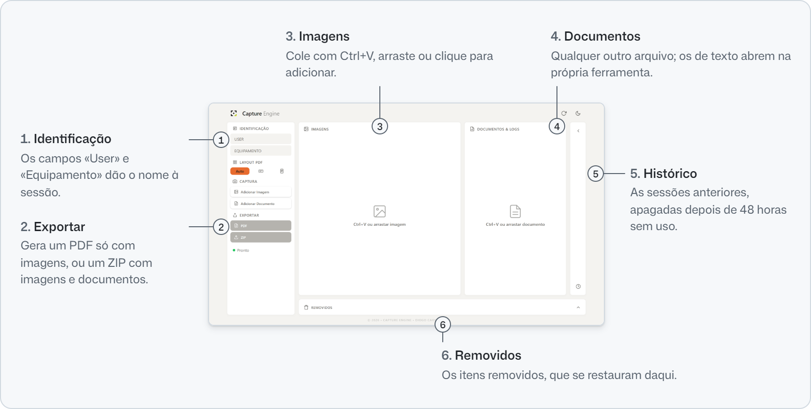
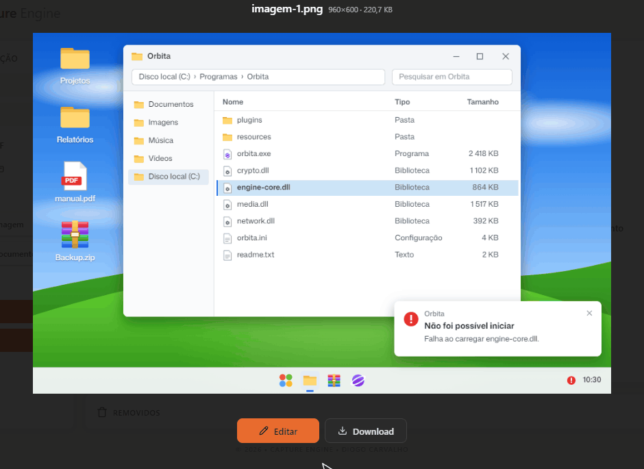
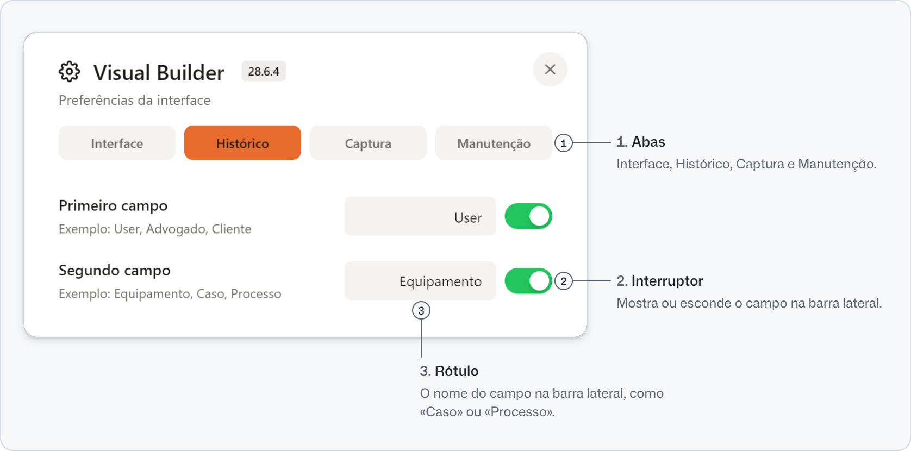
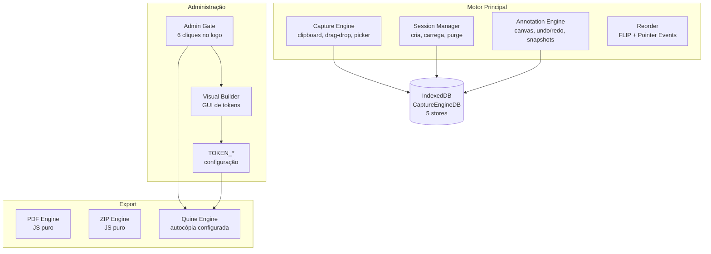
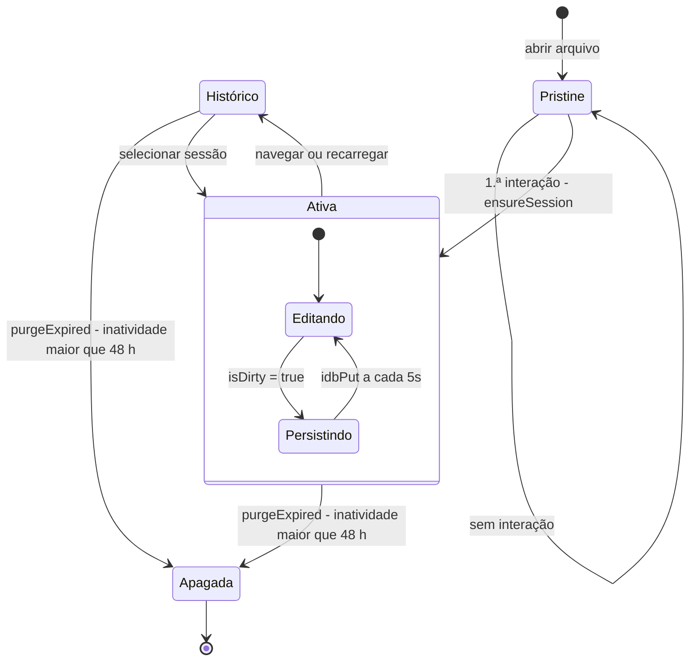
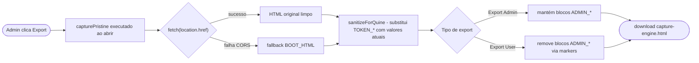

# Capture Engine

   

Ferramenta para capturar, organizar e exportar imagens e documentos como evidência, em PDF ou ZIP, num único arquivo HTML que abre no navegador e funciona sem internet.

<!-- cartoes: logotipo=docs/images/logo.svg; arquivo=capture-engine.html; site=diogocarvalhoinfo.github.io/capture-engine; cor=#e86b2e -->
<a href="https://github.com/diogocarvalhoinfo/capture-engine/releases/latest/download/capture-engine.html"><picture><source media="(prefers-color-scheme: dark)" srcset="docs/images/card-download-dark.svg"></picture></a><br>
<a href="https://diogocarvalhoinfo.github.io/capture-engine/"><picture><source media="(prefers-color-scheme: dark)" srcset="docs/images/card-site-dark.svg"></picture></a>

## Índice

1. [O que é](#1-o-que-é)
2. [Para quem é](#2-para-quem-é)
3. [Stack](#3-stack)
4. [Conceitos](#4-conceitos)
5. [Início rápido](#5-início-rápido)
6. [Funcionalidades](#6-funcionalidades)
7. [Modo administrador](#7-modo-administrador)
8. [Segurança e privacidade](#8-segurança-e-privacidade)
9. [Uso como prova](#9-uso-como-prova)
10. [Limitações conhecidas](#10-limitações-conhecidas)
11. [Resolução de problemas](#11-resolução-de-problemas)
12. [Perguntas frequentes](#12-perguntas-frequentes)
13. [Requisitos](#13-requisitos)
14. [Estrutura de arquivos](#14-estrutura-de-arquivos)
15. [Arquitetura interna](#15-arquitetura-interna)
16. [Contribuição](#16-contribuição)
17. [Licença e autor](#17-licença-e-autor)

## 1. O que é

<!-- imagem-anotada: url=http://127.0.0.1:8765/capture-engine.html; saida=docs/images/overview.png -->


1. **Identificação**: os campos «Quem» e «O que» dão o nome à sessão. <!-- anotação: alvo=#id-section-wrap; lado=esquerda; ponto=0,0.5 -->
2. **Exportar**: gera um PDF com o que está em Imagens, ou um ZIP com imagens e documentos. <!-- anotação: alvo=#export-section; lado=esquerda; ponto=0,0.5 -->
3. **Imagens**: cole com Ctrl+V, arraste, ou use «Adicionar imagem». <!-- anotação: alvo=#img-zone; lado=cima; ponto=0.5,0 -->
4. **Documentos**: qualquer outro arquivo; os de texto abrem na própria ferramenta. <!-- anotação: alvo=#doc-zone; lado=cima; ponto=0.9,0 -->
5. **Histórico**: as sessões anteriores, apagadas depois de 48 horas sem uso. <!-- anotação: alvo=#sb-rail; lado=direita; ponto=1,0.3 -->
6. **Removidos**: os itens removidos, que se restauram daqui. <!-- anotação: alvo=#trash-bar; lado=baixo; ponto=0.85,1 -->

O Capture Engine é **um único arquivo HTML** que contém a aplicação inteira de captura e exportação de evidências digitais. Não precisa de instalação, não requer internet, e não envia nenhum dado para servidores externos.

Tudo o que você captura (capturas de tela, documentos, textos) fica guardado localmente no navegador do seu computador. Quando exporta, o PDF ou ZIP é gerado diretamente no navegador, em memória, sem sair do seu dispositivo.

**Em termos simples:** funciona como uma pasta que vive dentro de um único arquivo. Você abre, cola ou arrasta arquivos, organiza, anota e exporta — tudo sem internet.

### Casos de uso

| Situação | Como o Capture Engine ajuda |
|---|---|
| Suporte técnico | Junta capturas de tela de erros, logs e configurações num único PDF para o ticket |
| Área jurídica | Reúne e exporta provas e documentos para processos ou audiências |
| Uso pessoal | Agrupa capturas para submeter num portal, chamado ou formulário |
| Ambientes restritos (banco, governo, saúde) | Funciona sem internet, sem CDN, sem registro de dados externos |
| Auditoria e conformidade | Evidências documentadas e exportadas sem sair do dispositivo |

> [!CAUTION]
> **Os dados não ficam guardados para sempre, e isto é de propósito.**
> Por privacidade, o Capture Engine **apaga sozinho** qualquer sessão que fique mais de 48 horas sem ser usada, e **não guarda cópias de segurança automáticas**. Para guardar um trabalho, exporte-o em **PDF** ou **ZIP** e guarde o arquivo. Só o que foi exportado fica garantido.

## 2. Para quem é

O Capture Engine tem **três tipos de usuários** com responsabilidades diferentes:

### Usuário Final
Usa a ferramenta para capturar, organizar e exportar. Não precisa saber que existe um modo administrador. Recebe o arquivo `capture-engine.html` já configurado e pronto para uso.

**O que consegue fazer:** capturar imagens e documentos, anotar imagens, reordenar, exportar PDF ou ZIP.

**O que não consegue fazer:** alterar cores, títulos, ou configurações da ferramenta.

### Administrador
Configura a ferramenta para a sua organização — personaliza o nome, cores, campos e rodapé — e depois distribui a versão configurada aos usuários finais.

**O que consegue fazer:** tudo o que o usuário final consegue, mais acesso ao painel Visual Builder (via 6 cliques no logo).

**O que não consegue fazer:** alterar o código-fonte diretamente.

### Desenvolvedor / Agente IA
Edita o código-fonte do `capture-engine.html` para adicionar funcionalidades, corrigir bugs ou adaptar o motor a novos requisitos. **Leia o documento `AGENTS.md` antes de qualquer modificação** — contém as regras absolutas, referência de funções, schema da base de dados, checklist de validação e como fechar uma versão.

## 3. Stack

HTML, CSS e JavaScript num único arquivo, o `capture-engine.html`, sem bibliotecas. Não há manifesto nem gerenciador de pacotes: o próprio arquivo é a aplicação.

## 4. Conceitos

Esta seção explica os termos técnicos usados em toda a documentação. Se encontrar um termo desconhecido, procure aqui primeiro.

### Quine
Um **Quine** é um programa capaz de produzir uma cópia exata de si próprio como saída. O Capture Engine usa este conceito no Export. O arquivo lê o seu próprio código-fonte, aplica as configurações atuais e gera um arquivo HTML igual, só com os tokens personalizados. Isto permite ao administrador distribuir versões configuradas sem precisar de servidores ou ferramentas externas.

### IndexedDB
**IndexedDB** é uma base de dados embutida no navegador, semelhante a um disco local dentro do navegador. O Capture Engine a usa para guardar sessões, imagens e documentos automaticamente — sem servidor, sem arquivos externos. Os dados persistem enquanto o usuário não limpar os dados do navegador.

**Importante:** Os dados do Capture Engine estão ligados ao navegador e ao computador onde foram criados. Se limpar o histórico/cache do navegador, os dados são apagados.

### Sessão
Uma **sessão** é um conjunto de trabalho — como um projeto ou pasta. Cada vez que abre o Capture Engine, começa uma sessão nova. Sessões anteriores ficam guardadas no histórico (ícone de relógio, lado direito).

### Token
Um **token** é uma variável de configuração do sistema. Por exemplo, `TOKEN_MAIN_COLOR` define a cor principal da interface. Os tokens são alterados pelo administrador no Visual Builder e ficam incorporados no arquivo HTML exportado.

### Visual Builder (VB)
O **Visual Builder** é o painel de configuração do administrador. É ativado com 6 cliques no logo no canto superior esquerdo. Permite alterar nome, cores, campos e rodapé da ferramenta sem editar código.

### Export Admin / Export User
As duas opções do botão de exportar, que na interface se chamam «Administrador» e «User»:
- **Export Admin** — gera uma cópia com todas as capacidades de administração. Outros admins podem reconfigurar e re-exportar.
- **Export User** — gera uma cópia limpa, sem painel de administração. Usuários finais recebem uma ferramenta focada apenas em capturar e exportar.

> [!CAUTION]
> **Exportar a ferramenta não é fazer backup dos dados.**
> O arquivo HTML gerado pelo Export contém **apenas a configuração** e o código da ferramenta. As imagens, documentos e histórico de sessões **não são exportados no HTML** — estes ficam permanentemente guardados no IndexedDB do navegador.

### Diagnóstico de Export

Se suspeitar que as configurações não foram aplicadas no arquivo exportado, pode verificar manualmente:
1. Abra o arquivo HTML exportado num editor de texto simples (Notepad, TextEdit).
2. Procure por `const TOKEN_MAIN_COLOR`.
3. Verifique se o valor corresponde à cor que escolheu no Visual Builder. Se ainda mostrar o valor padrão, pode haver uma falha no formato interno do token ou os marcadores de proteção não estão íntegros.

### Funcionamento sem internet
Um sistema isolado é aquele sem acesso à internet — comum em bancos, hospitais e organismos governamentais. O Capture Engine foi desenhado especificamente para funcionar nestes ambientes: zero dependências externas.

### XSS (Cross-Site Scripting)
**XSS** é um tipo de ataque onde código malicioso é injetado numa página web. O Capture Engine sanitiza (limpa) todos os dados inseridos pelo usuário antes de apresentá-los, impedindo este tipo de ataque.

### EMA (Exponential Moving Average)
**EMA** (média móvel exponencial) é o filtro que suaviza o desenho livre. Cada ponto novo mistura-se com o anterior por um fator α = 0.35. O tremor diminui, e o traço não fica atrasado de forma visível.

## 5. Início rápido

### Abrir a aplicação

**Método simples (qualquer sistema operacional):**
1. Baixe o `capture-engine.html` pelo cartão «Download», no topo deste README
2. Faça duplo clique no arquivo
3. O arquivo abre no navegador padrão

A versão publicada no GitHub Pages (cartão «Abrir o site», no topo) funciona igual. Guarda as sessões numa base separada da do arquivo baixado (ver «A base é por origem», na §11).

### Fluxo básico de trabalho

```
1. Abrir → Interface limpa, sem dados (estado inicial)
           ↓
2. Identificar (opcional) → preencher «Quem» e «O que»
           ↓
3. Capturar → Ctrl+V, arrastar arquivos, ou clicar "Adicionar imagem"/"Adicionar documento"
           ↓
4. Organizar → Arrastar itens para reordenar, clicar para ver ou anotar. Um PDF arrastado de Documentos para Imagens fica junto das fotos, e volta do mesmo jeito
           ↓
5. Exportar → PDF (imagens) ou ZIP (imagens + documentos)
```

### Dicas essenciais

- **Ctrl+V** cola qualquer coisa da área de transferência: imagem, arquivo ou texto
- **Arrastar e soltar** funciona: arraste diretamente da Área de Trabalho ou do explorador de arquivos
- O histórico de sessões anteriores está no ícone de relógio (barra lateral direita)
- O botão «Atualizar», no topo, recarrega a página e começa uma sessão nova; a anterior fica no histórico. Também no telefone e no tablet, onde abrir o site volta à última sessão
- Um item removido vai para a barra «Removidos», no fundo da tela, e pode ser restaurado
- A aplicação grava a cada 5 segundos. Fechar o navegador antes disso perde as últimas alterações

## 6. Funcionalidades

### 6.1 Captura de conteúdo

O Capture Engine aceita conteúdo de três formas:

| Método | Como usar | O que captura |
|---|---|---|
| **Ctrl+V** | Pressione Ctrl+V com a app em foco | Imagem da área de transferência, arquivo copiado, ou texto |
| **Arrastar e soltar** | Arraste o arquivo para a área de destino | Qualquer arquivo |
| **Seletor** | Clique em "Adicionar imagem" ou "Adicionar documento" | Qualquer arquivo pelo seletor do sistema |

**Tipos de arquivo aceitos:**

| Categoria | Formatos |
|---|---|
| Imagens | PNG, JPEG, WEBP, GIF (capturadas como imagens), também com uma extensão que o navegador não conhece: a imagem é reconhecida pelo conteúdo |
| Documentos de texto | TXT, CSV, XML, JSON, Markdown, HTML, e outros formatos de texto simples, que abrem no visualizador: o Markdown formatado, o CSV numa tabela, e o HTML como página, isolado, sem acesso aos dados do app nem à internet. «Editar» muda o texto puro, com Cancelar e Confirmar |
| PDF | Abre no visualizador, com o leitor do próprio navegador |
| Documentos binários | DOCX, XLSX, e qualquer outro formato (guardados mas não visualizáveis inline — disponíveis para download) |

**Nomeação automática sem colisões:**
Ao colar a segunda imagem, a app não sobrescreve a primeira — atribui automaticamente `imagem-2`, `imagem-3`, etc. Renomeações manuais seguem a mesma lógica — nunca geram nomes duplicados.

**Comportamento do Ctrl+V por tipo de conteúdo:**
1. Se a área de transferência contiver uma **imagem** → captura como imagem
2. Se a área de transferência contiver um **arquivo não-imagem** → captura como documento
3. Se a área de transferência contiver **texto** → captura como arquivo `.txt`

### 6.2 Visualizador de imagens (Zoom & Pan)

Ao clicar numa imagem, abre um visualizador com zoom e navegação. O título é o nome com a extensão, o mesmo que o Download grava, e logo depois dele vêm as dimensões e o tamanho.

| Ação | Como fazer |
|---|---|
| **Abrir** | Clicar na miniatura da imagem |
| **Zoom in/out** | Roda do mouse, centrado na posição do cursor. Um clique isolado anda 1 %; cliques seguidos aceleram, até 10 % por clique, e uma pausa volta a 1 %. No trackpad, o zoom segue a velocidade do gesto |
| **Pan (mover)** | Clicar e arrastar quando a imagem está ampliada |
| **Zoom com botões** | Botões + e −, 1 % por clique; segurar o botão repete o passo e acelera. O valor (ex.: 137 %) volta a 100 % com um clique. A barra aparece quando o zoom passa de 100 % |
| **Navegar ← →** | Botões de seta flutuantes nas laterais (visíveis quando há ≥2 imagens na sessão), ou teclas ArrowLeft / ArrowRight |
| **Fechar** | Botão × ou clicar fora da imagem (apenas quando zoom = 100%) |

**Limites de zoom:** 20% (mínimo) a 1000% (máximo).

**Motivo:** com a imagem ampliada, um clique fora para mover a imagem não fecha o visualizador sem querer.

### 6.3 Anotação de imagens

<!-- gif: url=http://127.0.0.1:8765/capture-engine.html; saida=docs/images/annotation-arrow.gif; preparo=capture-engine-editor-arrow; recorte=#img-modal-img, #img-modal-default-actions; passos=clicar #ann-toggle | clicar .ann-btn[data-tool=arrow] | arrastar #ann-canvas 18%,59% 31%,44% -->


No visualizador, o «Editar» abre as ferramentas. Com a Seta escolhida, um arrasto desenha a seta, e as ferramentas continuam abertas. Um clique sem arrasto também desenha uma seta, com a ponta no lugar do clique. O GIF termina antes do Confirmar, que salva as anotações na imagem.

Motor de anotação:
- O editor tem 8 ferramentas (desenho livre, retângulo, círculo, seta, marca-texto, texto, selecionar e recortar) e o botão Girar 90°.
  - Cada ferramenta fica ativa até se escolher outra. O Girar 90° gira a imagem e termina.
  - A barra tem também «Diminuir» e «Aumentar» (a espessura do traço ou o tamanho do texto), logo depois das ferramentas no computador e depois das cores no telefone, as 8 cores, «Desfazer», «Refazer», «Cancelar» e «Confirmar».
  - Cada ferramenta guarda a sua espessura. O desenho livre, o retângulo, o círculo e a seta começam com 4 px; o marca-texto, com 12 px. O texto começa com 24 e vai de 12 a 400 pelo − e o +; arrastando as alças, chega a qualquer tamanho entre 8 e 400. O ícone do desenho livre e o da seta engrossam e afinam com a espessura de cada um.
  - **Opções de uma ferramenta.** As ferramentas que desenham têm um ponto discreto acima do botão. Um clique na ferramenta já escolhida (no telefone, um toque) abre as opções numa bandeja logo acima. O duplo clique e o botão apertado por 1 s também abrem. As opções ficam lado a lado, sempre na mesma ordem, e a escolhida fica marcada. Cada uma mostra o nome ao passar o mouse. Com a bandeja aberta, o ponto fica na cor principal. Um clique fora, o Esc, outra ferramenta ou um novo clique na ferramenta fecham a bandeja; um clique na imagem já começa o desenho. Com o Texto, a bandeja fica aberta enquanto se digita, e o B, o I, o − e o + valem para o texto aberto. Pelo teclado, a seta para cima abre, e as setas para os lados andam entre as opções. A barra não muda de forma, e a bandeja acompanha a tela quando ela muda de tamanho.
    - Em todas, depois das opções: **−** e **+** soltos, sem a caixa de botão, e o tamanho atual depois deles. O tamanho é um ponto que cresce com o traço ou, no texto, o número. Fazem o mesmo que o − e o + da barra, que continuam lá. O desenho livre e a seta só têm o tamanho.
    - Retângulo e círculo: **Contorno** (o padrão) ou **Preenchido**, uma forma cheia na cor escolhida, que cobre o que está embaixo. Com «Preenchido», o botão da ferramenta mostra a forma cheia.
    - Marca-texto: uma faixa larga, de pontas retas, na cor escolhida. Ele começa no amarelo e guarda a sua cor, à parte da cor das outras ferramentas. **Translúcido** (o padrão, com o ícone de xadrez) deixa ver o que está por baixo, com 40 % de opacidade; **Sólido** cobre, para esconder uma informação. Com «Sólido», o botão da ferramenta mostra a ponta cheia.
    - Texto: **Negrito**, **Itálico** e **Com fundo**, que ligam e desligam cada um (o negrito e o itálico também com Ctrl+B e Ctrl+I). Com fundo, o texto fica sobre um retângulo na cor escolhida, com a letra escura ou branca, a que der mais contraste. O T da ferramenta mostra o estilo, o do texto selecionado ou o que vai ser usado: mais grosso com «Negrito», inclinado com «Itálico». Um duplo clique num texto o reabre para editar.
    - Com um retângulo, um círculo ou um marca-texto selecionado, a opção da mesma ferramenta muda também essa anotação, e o Ctrl+Z desfaz. Escolher outra ferramenta, ou o Texto, tira a seleção, e as opções voltam a valer para a ferramenta. Para mudar o negrito ou o itálico de um texto, faça um duplo clique nele e use as opções. As escolhas do retângulo, do círculo e do marca-texto ficam guardadas no navegador. A cada abertura do editor, o texto volta a 24, com o negrito ligado e o itálico desligado.
  - Ao passar o mouse sobre um botão, o nome dele aparece logo por cima e fica enquanto o mouse estiver lá. Chegando ao botão pelo teclado, aparece também. É o mesmo tooltip de toda a aplicação, branco por cima do editor.
  - Com anotações por salvar, fechar o editor (pelo ✕, pelo Esc ou por um clique fora) faz o Cancelar e o Confirmar crescerem duas vezes. Durante 5 s, os outros botões da barra ficam meio transparentes e não respondem. Um clique na imagem volta a editar.
- Selecionar: clique para selecionar qualquer anotação, caixa de seleção visível, apagar com Delete ou com a lixeira
- Mover: arrastar qualquer anotação para reposicionar. Em qualquer ferramenta, menos o Recortar, o botão direito ou o do meio sobre uma anotação a selecionam, com as alças e a lixeira, e já a arrastam. A barra passa ao Selecionar. Um clique fora das anotações, ou apagar a anotação, volta à ferramenta de antes
- Ctrl (Cmd no Mac): enquanto está apertado, qualquer ferramenta funciona como o Selecionar. Um clique numa anotação seleciona; arrastar move, e arrastar uma alça redimensiona. O botão Selecionar fica aceso enquanto isso. Ao soltar o Ctrl, a ferramenta de antes volta, sem alças na tela
- Redimensionar: alças nos 4 cantos de cada anotação, menos a seta. A seta tem uma alça em cada ponta: cada alça move só a sua ponta, e a seta nunca troca de direção. Numa seta curta, o meio continua a mover a seta. O texto muda de tamanho por escala contínua, e o tamanho novo aparece na bandeja do Texto e vale para o próximo texto
- Shift: o Retângulo desenha um quadrado, o Círculo um círculo perfeito (sem o Shift, ele desenha uma elipse), e a Seta e o Desenho livre andam em passos de 45°. Vale ao desenhar e ao redimensionar, também quando o Shift é apertado no meio do gesto
- Girar o texto: um texto selecionado tem, acima da caixa, um botão redondo com duas setas curvas, como no Paint. Gira em qualquer ângulo e prende em 0°, 90°, 180° e 270° quando passa perto; com Shift, anda de 15° em 15°. A caixa de seleção gira com o texto. O Girar 90° da imagem gira também os textos
- Alças do mesmo tamanho na tela em qualquer imagem: 12 px nas anotações e marcas de 20 px no recorte, com uma área de clique de 44 × 44 px. O recorte tem alças nos 4 cantos e no meio de cada lado; a do meio muda só esse lado. As marcas são brancas com contorno escuro, e a linha alterna traços pretos e brancos, para se verem em imagens claras e escuras. Sobre o recorte, o cursor mostra o que o arrasto faz: redimensionar numa alça, mover no meio da área
- Editar: alterar cor, espessura e tamanho de anotações já inseridas sem recriar
- Zoom: a roda do mouse, o trackpad e os botões + e − funcionam como no visualizador, para anotar um detalhe pequeno. Como arrastar desenha, para mover a imagem ampliada use a barra de espaço + arrastar, ou o botão do meio do mouse num lugar sem anotação. O duplo clique ainda edita um texto. A anotação é salva na resolução original, qualquer que seja o zoom
- Desfazer/Refazer: até 50 passos, histórico preservado ao navegar entre imagens da sessão
  - Nota: durante a edição, Desfazer/Refazer também revertem o recorte e o Girar 90°. Mas **depois de salvar e reabrir a imagem**, o Desfazer/Refazer passa a reverter apenas as anotações (setas, texto, traços) — o crop e a rotação já salvos não são revertidos. As anotações ainda voltam para a posição exata.

No telefone:
- O desenho por toque funciona (Pointer Events).
- A página por trás não rola enquanto um modal está aberto.
- Os botões de apagar e de restaurar ficam sempre visíveis.
- A barra quebra em linhas conforme a largura: as ferramentas, as cores com o − e o +, e as ações. Até 480 px, as ferramentas, o 90° e o Recortar ficam numa linha só, e os botões encolhem até 30 px quando a tela é mais estreita.

### 6.4 Marcar, menus e reordenação

Cada imagem e cada documento tem uma caixa de marcar, que aparece com o mouse em cima. O clique direito abre um menu com o que serve no lugar: abrir, editar, copiar a imagem (Ctrl+C), duplicar, renomear (F2), baixar e remover (Del). Num PDF, «Diminuir o tamanho» cria uma cópia menor, em três níveis, com o tamanho de cada um à direita. Com vários marcados, o menu baixa os marcados num .pdf ou num .zip, ou os remove. Com dois ou mais PDFs marcados, «Juntar em um PDF» cria «juntado.pdf» em Documentos, com as páginas na ordem da lista. Esc, ou um clique fora dos itens, desmarca tudo.


Todos os itens (imagens e documentos) podem ser reordenados por **drag & drop**:
- Em imagens: arraste a miniatura para a posição desejada na grade
- Em documentos: arraste o card para cima ou para baixo na lista

A nova ordem é guardada automaticamente.

### 6.5 Removidos

Um item removido não é apagado na hora: vai para a barra «Removidos», no fundo da tela.

| Ação | Como fazer |
|---|---|
| **Ver itens removidos** | Clicar na barra "Removidos" na parte inferior |
| **Restaurar item** | Abrir o item na barra «Removidos» → botão «Restaurar» |

Cada sessão guarda os seus itens removidos. Eles ficam lá até serem restaurados ou até a sessão expirar.

Não existe «apagar definitivamente» na barra «Removidos». Um item removido sai de lá por uma de duas vias: **restauração**, ou **expiração da sessão** (o purge apaga a sessão e tudo o que lhe pertence, incluindo os removidos).

> [!CAUTION]
> **A barra «Removidos» não guarda sessões inteiras.**
> A rede de segurança acima vale para **itens** (imagens e documentos). Apagar uma **sessão** no ✕ («Eliminar sessão») da barra de histórico é **imediato, permanente e sem pedido de confirmação** — remove a sessão e todo o seu conteúdo, incluindo os itens removidos dela. Não há como desfazer. Antes de apagar uma sessão que ainda pode ser útil, exporte-a em PDF ou ZIP.

### 6.6 Export PDF

Gera um PDF com tudo o que está em Imagens: uma foto por página e, no lugar do cartão de um PDF, as páginas dele, na ordem da grade.

Depois de gerar o PDF ou o ZIP, o botão fica verde, com «Concluído», até a próxima ação na página: um clique, uma tecla, colar ou arrastar. Ir a outra janela anexar o arquivo e voltar não tira o verde, por isso a última ação continua à vista.

**Modos de página disponíveis:** na barra lateral, «Auto» é escrito; «Horizontal» e «Vertical» são ícones de página, com o nome no tooltip.

| Modo | Comportamento |
|---|---|
| **Auto** | Detecta orientação de cada imagem individualmente (retrato ou paisagem) |
| **A4 Vertical** | Força todas as páginas em formato retrato |
| **A4 Horizontal** | Força todas as páginas em formato paisagem |

**Processo de geração:**
1. As imagens são convertidas para JPEG em memória (qualidade configurável, padrão 92%)
2. O PDF é construído com uma imagem por página, escalada para preencher o máximo da página A4 mantendo a proporção, centrada. As páginas de um PDF que está em Imagens entram como estão, com o tamanho e o texto delas
3. O arquivo é transferido automaticamente

**Quando o botão PDF fica desativado:** Quando há documentos na sessão. O .pdf leva só o que está em Imagens. Para sessões com documentos, use o ZIP, ou arraste o PDF para Imagens.

**Os arquivos originais não são alterados.** A conversão JPEG acontece apenas na memória, durante a geração do PDF. Os originais ficam na sessão no formato em que foram capturados.

**GIF animados no PDF:** apenas o primeiro quadro é incluído — a animação se perde. Para preservar a animação, use o export ZIP.

### 6.7 Export ZIP

Empacota todos os itens da sessão (imagens e documentos) num único arquivo ZIP.

**O que é incluído:**
- Imagens **não anotadas** em PNG, byte a byte iguais ao original, sem recompressão
- Imagens **anotadas, giradas ou recortadas** como PNG novo, com as edições incorporadas (ver nota abaixo)
- GIF animados **não editados** no formato original, com a animação intacta — anotar, girar ou recortar converte-os num PNG estático, tal como qualquer outra imagem (ver a nota abaixo)
- Documentos em todos os formatos
- Nomes de arquivo limpos baseados nas legendas/nomes definidos (ex: `imagem-1.png`, `relatorio.pdf`)

> [!CAUTION]
> **O ZIP leva a imagem que você vê, e não a que colou.**
> Assim que uma imagem é **anotada, girada ou recortada**, o ZIP leva a versão editada. É um PNG novo, gerado a partir do canvas, com as edições incorporadas. É o comportamento pretendido: as anotações fazem parte do trabalho e devem acompanhar a exportação.
>
> A consequência é que **o arquivo original deixa de estar no ZIP** para essas imagens. Ele continua guardado no navegador (o motor de anotação preserva-o para permitir reeditar e desfazer), mas **não há forma de o exportar** — e desaparece quando a sessão expira. Se precisar de conservar o original intacto de uma imagem que vai anotar, **exporte o ZIP antes de a editar**.

**Acentos e espaços nos nomes:** são preservados tal como você os escreveu — `Diagnóstico Antônio` produz `Diagnóstico Antônio.png` numa imagem e `Diagnóstico Antônio.txt` num documento, sem diferença entre os dois. O ZIP declara a codificação UTF-8 no cabeçalho (bit 11). É isso que faz o Explorer do Windows, o WinRAR, o 7-Zip e o macOS lerem os acentos. Caracteres que o Windows não aceita em nomes de arquivo (`\ / : * ? " < > |`) ainda são removidos das legendas de imagem, porque criariam um arquivo impossível de extrair.

> [!NOTE]
> **Nomes de ZIPs antigos.**
> Nas versões antigas, os nomes eram gravados em UTF-8 sem essa declaração no cabeçalho, e os acentos apareciam trocados (`Diagn+¦stico`) ao abrir o ZIP. A legenda de imagem também convertia espaços em hífens, ao contrário do nome de documento. ZIPs gerados antes da correção mantêm os nomes antigos — o conteúdo dos arquivos nunca foi afetado. Basta reexportar para obter os nomes corretos.

**Opções de ZIP (quando há imagens na sessão):**
- **Imagens em PDF** — inclui as imagens como PDF + documentos separados
- **Imagens separadas** — inclui tudo como arquivos individuais

### 6.8 Sessões e histórico

**Comportamento ao abrir:**
Cada abertura do Capture Engine começa com uma sessão nova em branco. A interface abre limpa — sem dados de sessões anteriores. Sessões anteriores ficam guardadas no histórico.

No telefone e no tablet é diferente: a ferramenta volta à última sessão, como os apps de um telefone. Vale depois de trocar de app, de fechar o Safari ou numa aba nova. Para começar outra, toque em «Atualizar» (a seta circular), no topo; a anterior fica no histórico.

**Quando a sessão aparece no histórico:**
A sessão nova só aparece no histórico após a primeira interação real (colar uma imagem, escrever o nome do usuário, arrastar um documento). Sessões sem interação não são guardadas.

**Identificação de sessão:**
- **Nome da sessão** — derivado automaticamente dos campos de Identificação («Quem» e «O que», separados por hífen). Com «Maiúsculas» ligado, o padrão, o nome sai em maiúsculas; desligado, sai como foi digitado. Os rótulos dos dois campos são configuráveis no Visual Builder.
- **Campo «Quem»:** quem fez o registro, por exemplo o nome do usuário (rótulo configurável)
- **Campo «O que»:** o que foi registrado, por exemplo o computador ou o equipamento (rótulo configurável)
- Se não for preenchido nenhum nome, a sessão recebe um identificador automático (`#0001`, `#0002`, etc.)

**Purge automático:**
Sessões sem atividade há mais de 48 horas (configurável) são apagadas automaticamente ao abrir a aplicação. O critério é a data de **última atividade**, não a data de criação.

**Navegar entre sessões:**
1. Clicar no ícone de relógio (barra lateral direita)
2. Selecionar a sessão desejada na lista
3. A sessão atual é guardada antes de navegar

## 7. Modo administrador

### 7.1 Ativar o modo administrador

O painel de administração não é visível por padrão. Para ativá-lo:

1. Clique 6 vezes seguidas no logo, no canto superior esquerdo, em menos de 3 segundos. Os cliques com mais de 3 s não contam.
2. Use os dois botões que aparecem na barra de topo: a engrenagem abre o Visual Builder, e o disquete exporta uma cópia.

Para desativar, clique 3 vezes no logo em menos de 1 segundo. Fechar o Visual Builder pelo ✕ também desativa o modo administrador: para exportar, use o disquete antes de abrir o Visual Builder, ou ative o modo de novo. O modo administrador não continua ativo depois de fechar a aplicação: ative-o de novo em cada abertura.

<!-- imagem-anotada: url=http://127.0.0.1:8765/capture-engine.html; saida=docs/images/admin-mode.png; preparo=capture-engine-admin-mode; recorte=#vb-overlay .sb-modal -->


1. **Abas**: Interface, Histórico, Captura e Manutenção. <!-- anotação: alvo=.sb-tabs; lado=direita; ponto=1,0.5 -->
2. **Interruptor**: o de cada campo o mostra ou esconde na barra lateral. <!-- anotação: alvo=label:has(#cfg-show-pc); lado=direita; ponto=1,0.5 -->
3. **Rótulo**: o nome do campo na barra lateral, como «Caso» ou «Processo». <!-- anotação: alvo=#cfg-equip-label; lado=baixo; ponto=0.5,1 -->

### 7.2 O Visual Builder

O Visual Builder é o painel de configuração. Tem quatro abas: Interface, Histórico, Captura e Manutenção.

**Aba Interface:**
- «Cor principal»: a cor de destaque, em hex ou pelo seletor de cor
- «Cor do texto sobre destaque»: automática, ou escolhida à mão
- «Texto inicial», «Texto em destaque» e «Texto final»: as três partes do nome no topo, cada uma com a sua cor
- «Texto do rodapé»: `{YEAR}` vira o ano atual. É a marca da organização, e não substitui o aviso de copyright do código e do `LICENSE`

**Aba Histórico:**
- «Primeiro campo»: o rótulo (por padrão, «Quem») e o interruptor que mostra ou esconde o campo na barra lateral
- «Segundo campo»: o rótulo (por padrão, «O que») e o interruptor que mostra ou esconde o campo na barra lateral
- «Maiúsculas»: ligado, o padrão, converte para maiúsculas o que se digita nos dois campos; desligado, o texto fica como foi digitado

**Aba Captura:**
- «Qualidade do PDF»: de 70 a 95 %, só para o PDF; os originais não mudam
- «Dimensão máxima»: ao gerar o PDF, reduz as imagens a 1920, 2560 ou 3840 px; «Original» não reduz, e o que fica guardado não muda

**Aba Manutenção:**
- «Limpeza automática»: remove as sessões sem uso há mais de 8 h, 24 h ou 48 h, ou «Nunca»

**Nota importante:** As alterações feitas no Visual Builder são **temporárias** até ser feito um Export. Ao fechar e reabrir o arquivo, as configurações voltam ao padrão guardado no arquivo.

### 7.3 Guardar configurações (Export)

O botão Export abre o painel de exportação com duas opções:

**Export Admin:**
- Gera uma cópia do arquivo com as configurações atuais
- Mantém o painel de administração e a capacidade de re-exportar
- Use para distribuir a outros administradores ou como backup da configuração

**Export User:**
- Gera uma cópia limpa do arquivo com as configurações atuais
- Remove o painel de administração, o Visual Builder e a capacidade de re-exportar
- Ativa automaticamente o modo de produção (logs desativados)
- Use para distribuir aos usuários finais

**Fluxo de distribuição típico:**
```
Admin configura → Export Admin (backup) → Export User → distribui aos usuários
```

> [!NOTE]
> **Atualizações e continuidade dos dados.**
> Uma versão nova da ferramenta não apaga o histórico de quem a usa: todas as cópias abertas no mesmo perfil de navegador leem a mesma base. As exceções estão na §11, em «Perdi o arquivo HTML. Perdi os dados?».

### 7.4 Tokens de configuração

Os tokens são as variáveis internas que controlam o comportamento da ferramenta. O Visual Builder edita estes tokens graficamente. Os valores padrão estão no [`design-tokens.md`](design-tokens.md), §6.

| Token | O que controla |
|---|---|
| `TOKEN_TITLE_START` | Primeira parte do nome no topo (cor normal, negrito). O espaço final é intencional. |
| `TOKEN_TITLE_ACCENT` | Segunda parte (na cor de destaque, mais transparente) |
| `TOKEN_TITLE_END` | Terceira parte do nome (cor normal, negrito). Espaços manuais. Campo «Texto final» no Visual Builder. Exemplo de white-label: 'Capture Engine Pro' — onde 'Pro' ocuparia o terceiro span com cor de destaque independente |
| `TOKEN_TITLE_START_COLOR` | Cor da 1.ª parte do título (vazio = usa a cor normal do texto) |
| `TOKEN_TITLE_ACCENT_COLOR` | Cor da 2.ª parte do título (vazio = usa a cor de destaque) |
| `TOKEN_TITLE_END_COLOR` | Cor da 3.ª parte do título (vazio = usa a cor normal do texto) |
| `TOKEN_MAIN_COLOR` | Cor principal da interface |
| `TOKEN_ACCENT_FG_OVERRIDE` | Cor do texto sobre a cor principal (vazio = automático) |
| `TOKEN_FOOTER_TEXT` | Texto do rodapé |
| `TOKEN_SHOW_SESSION_USER` | Mostra/oculta o primeiro campo (Quem) |
| `TOKEN_SHOW_SESSION_PC` | Mostra/oculta o segundo campo (O que) |
| `TOKEN_USER_LABEL` | Rótulo do primeiro campo (vazio = usa «Quem») |
| `TOKEN_EQUIP_LABEL` | Rótulo do segundo campo (vazio = usa «O que») |
| `TOKEN_ID_UPPERCASE` | Converte para maiúsculas o que se digita nos dois campos (desligado = o texto fica como foi digitado) |
| `TOKEN_JPEG_QUALITY` | Qualidade de compressão JPEG no export PDF |
| `TOKEN_MAX_IMG_DIMENSION` | Dimensão máxima das imagens **na geração do PDF** (0 = sem limite). Não afeta o armazenamento: as imagens são sempre guardadas no formato original |
| `TOKEN_AUTO_PURGE_HOURS` | Horas sem uso até a limpeza automática: 8, 24, 48 ou 0 («Nunca»), como no Visual Builder. Ver a nota abaixo da tabela. |
| `TOKEN_DEBUG_MODE` | Logs no console do navegador (desativado em Export User) |

**Limpeza automática (`TOKEN_AUTO_PURGE_HOURS`).** A limpeza usa sempre o valor atual do token. Por isso, uma versão nova com um valor menor apaga, na primeira abertura, sessões que antes sobreviveriam. O valor 0 desliga a limpeza; no Visual Builder, é a opção «Nunca». Um valor escrito à mão sem botão correspondente volta a 48 na próxima reexportação pelo Visual Builder.

### 7.5 Distribuir uma atualização (nova versão)

Quando existe uma nova versão do `capture-engine.html` e há usuários com sessões ativas:

**Os dados das sessões não estão no arquivo HTML** — estão no IndexedDB do navegador. Substituir o arquivo não apaga nem migra dados. O fluxo correto é:

```
1. Antes de atualizar — fazer Export Admin da versão atual
   (preserva as configurações personalizadas — cores, nome, campos, rodapé)
         ↓
2. Abrir o novo capture-engine.html num editor de texto
   Aplicar manualmente as configurações guardadas (ou re-configurar no Visual Builder)
         ↓
3. Fazer Export User → distribuir o novo arquivo aos usuários
         ↓
4. Os usuários abrem o novo arquivo — as sessões anteriores aparecem automaticamente
   (o IndexedDB é compartilhado por perfil de navegador, não pelo arquivo)
```

**O que é seguro:**
- Substituir o arquivo em qualquer pasta ou com qualquer nome — os dados continuam acessíveis
- Uma versão mais nova vê as sessões criadas numa versão mais antiga (todos usam `CaptureEngineDB`)

**O que requer atenção:**
- Configurações personalizadas (cores, nome, tokens) **não viajam** com os dados — são parte do arquivo HTML e precisam ser reaplicadas manualmente ou via Export Admin
- Se a nova versão incrementar a versão do schema IndexedDB (atualmente `2`), consultar `AGENTS.md` §6 sobre migração de schema antes de distribuir

**Aviso sobre `TOKEN_AUTO_PURGE_HOURS`:** se a nova versão tiver um valor de purge menor do que o anterior, sessões que ainda estariam vivas são purgadas na primeira abertura. Ver §7.4.

## 8. Segurança e privacidade

| Característica | Detalhe |
|---|---|
| **Zero dependências externas** | Sem CDNs, sem bibliotecas remotas, sem Google Fonts — nada carregado da internet |
| **Isolado, sem internet** | Funciona sem internet; nenhum dado sai do dispositivo |
| **Sanitização de campos** | Todo o texto inserido pelo usuário é sanitizado antes de ser apresentado (proteção XSS) |
| **Content Security Policy** | Metatag CSP no cabeçalho HTML restringe scripts e recursos que podem ser carregados. Diretivas ativas: `default-src 'self' blob: data:; script-src 'unsafe-inline' (necessário: todo CSS e JS está inline por contrato de arquivo único; o Quine gera novos arquivos e invalidaria nonces a cada export); style-src 'unsafe-inline'; img-src blob: data:; connect-src 'self';` |
| **Admin Gate oculto** | O painel de admin requer 6 cliques no logo — invisível e inatingível acidentalmente |
| **Sem registro** | Nenhum dado de utilização, telemetria ou analytics |
| **Sem cookies** | Usa IndexedDB e localStorage do navegador (sem cookies de sessão) |

### Content Security Policy — nota sobre `unsafe-inline`

A CSP ativa inclui `script-src 'unsafe-inline'` e `style-src 'unsafe-inline'`. Isto é uma **consequência estrutural da arquitetura single-file**, não uma escolha de comodidade:

- Toda a lógica JavaScript está inline no único arquivo HTML — sem `unsafe-inline`, o navegador bloquearia o próprio script da aplicação.
- Nonces e hashes são incompatíveis com o Quine Engine: o conteúdo do arquivo muda a cada Export, invalidando qualquer hash calculado no build.
- A CSP ainda protege contra **scripts externos**, **recursos de rede** (`connect-src 'self'`) e **imagens externas** (`img-src blob: data:`).
- O bloqueio de scripts externos vem do próprio `script-src 'unsafe-inline'`, e **não** do `default-src`. Declarado, o `script-src` substitui o `default-src` para scripts. Como não nomeia nenhuma origem de URL, nem sequer `'self'`, recusa tudo o que não seja inline. O resultado é mais restritivo do que o `default-src` sozinho daria, e não menos.

> [!NOTE]
> **Avisos de scanners.**
> Em scanners de segurança automáticos (OWASP ZAP, Lighthouse), `unsafe-inline` será marcado como aviso. O contexto acima explica por que é intencional neste modelo.

### Aviso sobre limpeza do navegador

Os dados do Capture Engine estão guardados no IndexedDB do navegador. **Se limpar os dados de navegação, cache, ou histórico do navegador, os dados do Capture Engine são apagados permanentemente.** Exporte sempre os dados importantes antes de limpar o navegador.

### Comportamento com múltiplas abas

O Capture Engine pode ser aberto em várias abas do mesmo navegador — todas compartilham a mesma base de dados local. **Atenção:** todas as abas gravam na mesma base. Se a mesma sessão for editada em duas abas ao mesmo tempo, a última gravação apaga as alterações da outra. Para evitar confusão, trabalhe numa sessão de cada vez. Em versões anteriores, abrir uma segunda aba mostrava uma tela de erro que bloqueava o uso; esse bloqueio foi removido.

## 9. Uso como prova

O Capture Engine é adequado para **coleta organizada e documentação** de evidências digitais, mas não constitui por si só uma cadeia de custódia forense verificável.

**O que a ferramenta garante:**
- Timestamp de criação e última atividade registrado por sessão (gerado pelo navegador do dispositivo)
- Armazenamento local isolado — os dados não saem do dispositivo sem ação explícita do usuário
- Exportação ZIP **de imagens não editadas** com os arquivos originais, byte a byte, sem reprocessamento

**O que a ferramenta não garante:**
- Integridade criptográfica — não há hash, assinatura digital nem timestamping independente
- Imutabilidade — os dados no IndexedDB são editáveis pelo usuário e pelo próprio navegador
- Rastreabilidade de cadeia de custódia — não há registro de acessos ou modificações
- **Exportação PDF:** as imagens são recomprimidas como JPEG em memória, com perda. Não serve como prova primária quando se exige a integridade pixel a pixel; para isso, use o ZIP de imagens não editadas
- **Exportação ZIP de imagens editadas:** anotar, girar ou recortar substitui o arquivo exportado por um PNG gerado a partir do canvas. O original **não vai no ZIP** e não é exportável por nenhuma via — fica apenas no navegador, até a sessão expirar. Para conservar o original de uma imagem que vai editar, **exporte antes de a editar**

> [!CAUTION]
> **O original de uma imagem editada não se recupera depois.**
> Esta é a limitação mais relevante para uso probatório. Não existe caminho na interface que exporte o arquivo tal como foi capturado depois de ele ser anotado. Se a integridade pixel-a-pixel do material original for exigida, **exporte o ZIP imediatamente após a captura**, antes de qualquer edição, e guarde esse arquivo como referência.

Para uso em processos judiciais ou auditorias reguladas, complementar com procedimentos de custódia externos (hash independente dos arquivos exportados, registro de acesso, etc.).

## 10. Limitações conhecidas

| Limitação | Detalhe |
|---|---|
| **Sem sincronização** | Os dados só existem no navegador do computador onde foram criados. Não há sincronização entre dispositivos. |
| **Dependente do navegador** | Limpar dados do navegador apaga todos os dados. |
| **Múltiplas abas compartilham a base** | Pode abrir em várias abas, mas todas usam a mesma base de dados local. Editar a mesma sessão em duas abas ao mesmo tempo pode fazer uma sobrepor a outra (prevalece a última gravação). |
| **PDF sem documentos** | O export PDF leva só o que está em Imagens: as fotos e os PDFs arrastados para lá. Os documentos (DOCX, XLSX, etc.) requerem o export ZIP. Um PDF protegido por senha, em Imagens, para o export PDF. |
| **Sem pré-visualização de binários** | Os documentos do Word, do Excel e do PowerPoint não têm pré-visualização, só o Download. O PDF abre no leitor do próprio navegador. |
| **PDF no iPhone** | O PDF abre no leitor do próprio navegador. No iPhone, o Safari pode mostrar só a primeira página; isso ainda não foi testado num iPhone. |
| **Cópias anteriores à 29** | Depois de abrir a versão 29 num navegador, uma cópia mais antiga, no mesmo navegador, não abre mais as sessões: mostra «Armazenamento indisponível», e as capturas ficam só na aba. Nada se perde; a 29 mostra tudo. Use sempre a versão mais nova. |
| **Lista do .7z** | Um .zip, .tar, .tar.gz ou .rar mostra a lista de arquivos; um .7z não, porque guarda essa lista comprimida. |
| **Quota do navegador** | Com o espaço do navegador esgotado, as capturas novas deixam de ser gravadas e ficam só na aba aberta, e um aviso vermelho aparece no topo. Ver a nota abaixo da tabela. |
| **Navegação privada** | Em alguns navegadores, a navegação privada não deixa gravar as capturas. Elas ficam na aba aberta, a barra de estado diz «Só nesta aba», e um aviso vermelho aparece no topo. Exporte em PDF ou ZIP antes de fechar a aba. |
| **Aba privada no iPhone** | Numa aba privada, as capturas não são gravadas. Se o Safari recarregar ou fechar a aba, elas se perdem: exporte antes de sair do Safari. |
| **Sem limite fixo de itens** | A ferramenta não impõe um número máximo de imagens ou documentos; o limite prático é o espaço de armazenamento do navegador (ver linha acima). Em sessões muito grandes, o export de PDF/ZIP fica mais lento, porque tudo é processado na memória do navegador. |
| **Limites do motor ZIP (sem ZIP64)** | O ZIP é escrito à mão em JavaScript puro, no formato clássico: a contagem de entradas ocupa 16 bits e os tamanhos e deslocamentos 32 bits. Na prática isso significa **no máximo 65.535 arquivos por ZIP** e **cerca de 4 GB** por arquivo e no total do pacote. Acima desses limites os valores truncam **sem gerar erro** — o ZIP seria produzido e baixado, mas sairia corrompido. Não há aviso na interface. Estes números estão muito acima do que a memória do navegador aguenta ao montar o pacote, e o navegador falha primeiro. O cenário é improvável; fica declarado porque a falha é silenciosa. |
| **Formatos que o navegador não abre** | Uma foto HEIC, TIFF ou RAW vai para «Documentos», com o nome e os bytes originais, e um aviso diz porquê. O PDF só leva as imagens que o navegador desenha; o ZIP leva o arquivo original. No Safari, que abre HEIC, a foto fica em «Imagens». |
| **PNG com transparência no PDF** | Imagens com fundo transparente exportadas para PDF recebem fundo branco (o formato JPEG interno do PDF não suporta transparência). **O export ZIP preserva a transparência** — inclusive em imagens anotadas, porque o canvas de anotação mantém o canal alfa. Se a imagem não tiver sido editada, o PNG sai byte a byte igual ao capturado; se tiver, sai um PNG novo mas ainda transparente. |
| **GIF animados — comportamento por export** | **Enquanto não for editada:** o export **ZIP** inclui o GIF original, com a animação intacta. **Depois de anotar, girar ou recortar:** o `ann-save` regenera a imagem em PNG, a partir do canvas, e a animação perde-se também no ZIP. O arquivo sai com a extensão `.png`, e não como um `.gif` parado. O export **PDF** converte cada frame para JPEG e renderiza apenas a primeira, editada ou não. Para preservar a animação: use o ZIP **e não edite a imagem**. |

**Quota do navegador.** O navegador limita o espaço do IndexedDB. Quando ele esgota, um aviso vermelho fixo aparece no topo, e o erro fica no console (F12). O que já estava gravado não se corrompe, mas uma captura nova pode não ser gravada. Cada imagem PNG usa, em geral, de 100 KB a 2 MB. Com 100 a 150 imagens de alta resolução, uma sessão chega a 200–500 MB: a partir daí, exporte com frequência. O script de diagnóstico do `AGENTS.md` §14 mostra o uso real.

## 11. Resolução de problemas

### A aplicação não abre ou mostra página em branco
- Verifique se usa Chrome 90+, Edge 90+, ou Firefox 151.0.4
- Experimente abrir diretamente com duplo clique no `capture-engine.html`
- Em alguns sistemas, arquivos HTML locais precisam de permissão — verifique as configurações de segurança do navegador

### Os dados desapareceram
- Os dados do Capture Engine ficam no IndexedDB do navegador. Se limpou os dados do navegador (histórico, cache, dados de sites), os dados foram apagados.
- Os dados só existem no computador e navegador onde foram criados.
- Certifique-se de exportar os dados importantes antes de limpar o navegador.

### O Ctrl+V não cola nada
- Clique primeiro dentro da área da aplicação (fora de qualquer campo de texto) para garantir que a app tem foco
- No telefone, use «Adicionar imagem» e «Adicionar documento». O Ctrl+V funciona com um teclado ligado ao telefone
- Verifique se o navegador tem permissão para acessar a área de transferência (aparece uma notificação)
- Ctrl+V suporta múltiplos arquivos copiados do Explorer em simultâneo (Ctrl+C nos arquivos → Ctrl+V na aplicação).

### O botão PDF está desativado
- O export PDF só funciona com imagens. Se há documentos (PDF, DOCX, etc.) na sessão, o botão desativa automaticamente.
- Use o export ZIP para sessões com imagens e documentos juntos.

### O editor não fecha com Escape
- Com as opções de uma ferramenta abertas, o Escape fecha só as opções. Pressione de novo para fechar o editor.
- Com anotações por salvar, o Escape não fecha: o Cancelar e o Confirmar crescem, como num clique fora. Escolha um dos dois.

### Sessões com mais de 48 horas desapareceram
- O purge automático apaga sessões sem atividade há mais de 48 horas (configurável). Este comportamento é intencional e pode ser ajustado pelo administrador via `TOKEN_AUTO_PURGE_HOURS`.

### As minhas capturas desapareceram depois de fechar o navegador
- O mais provável é que o navegador não tenha deixado gravar: a quota de armazenamento esgotou, ou a aba era de navegação privada. Nos dois casos, um aviso vermelho aparece no topo da aplicação.
- A captura que não grava continua na grade enquanto a aba estiver aberta, e a barra de estado diz «Só nesta aba». Ao fechar a aba, a captura desaparece. Por isso, exporte em PDF ou ZIP antes de fechar.
- **Como confirmar:** abra as DevTools (F12) → aba Console → procure erros com a palavra `quota` ou `storage`.
- **Como prevenir:** em sessões grandes, exporte com frequência (PDF ou ZIP) e apague no histórico as sessões que já não precisa. **Não existe forma de reduzir o espaço que cada captura ocupa** — as imagens são sempre gravadas no formato original. O `TOKEN_MAX_IMG_DIMENSION` do Visual Builder reduz as imagens apenas na geração do PDF, não no armazenamento, e por isso não previne este problema.
- **Editar uma imagem duplica, mais ou menos, o espaço que ela ocupa.** Ao confirmar a primeira anotação, rotação ou recorte, o registro passa a guardar **dois** blobs: o original (`origBlob`, para poder desfazer e reeditar) e a versão editada. É o custo de manter o original recuperável, e conta para a quota. Numa sessão em que quase tudo é anotado, conte com cerca do dobro do espaço.

### Perdi o arquivo HTML. Perdi os dados? (Disaster Recovery)
- **Provavelmente não.** Os dados não estão dentro do arquivo HTML: ficam no IndexedDB do navegador, numa base compartilhada por **perfil de navegador**. Testado no Windows 11, com o Edge 148, o Chrome 148 e o Firefox, e no Safari do iPhone (iOS 26.5), no site publicado. O Safari do Mac não foi testado. Se apagou o `capture-engine.html`, basta abrir **qualquer** cópia da ferramenta no **mesmo perfil do mesmo navegador** e as sessões reaparecem.
- **O que NÃO afeta o acesso aos dados** (testado): o **nome** do arquivo, a **pasta**, o **disco**, os espaços ou caracteres especiais no caminho, e a **versão**, a partir da mesma série: todas usam a mesma base `CaptureEngineDB`. A exceção é uma cópia anterior à versão 29 aberta depois de uma 29, que não abre a base (ver «Limitações conhecidas»). Em todos esses casos, os dados continuam acessíveis, desde que seja o mesmo perfil.
- **O que NÃO encontra os dados** (outra origem ou outro perfil):
  - **janela anônima ou privada**;
  - **outro perfil** do navegador;
  - **outro navegador** (o Edge e o Chrome têm bases separadas);
  - no iPhone, o **atalho do site na Tela de Início**, que tem uma base própria, separada da do Safari;
  - abrir **de dentro de um ZIP**, sem extrair.
- **A base é por origem (protocolo, host e porta), e não só por perfil.** A *mesma* ferramenta aberta como arquivo (`file://`), servida localmente (`http://localhost:8080`) e publicada (`https://…github.io`) tem **três bases independentes**. As sessões de uma não aparecem nas outras, mesmo no mesmo navegador e perfil. *Dentro* da mesma origem (ex.: várias cópias `file://` no mesmo perfil), o nome e a pasta do arquivo não importam; *entre* origens diferentes, os dados nunca se misturam. Relevante ao distribuir a ferramenta hospedada **e** como arquivo local — cada modo guarda em separado.
- **Os dados são locais a cada máquina e NÃO viajam com a conta.** Mesmo com a sincronização do Chrome ligada, abrir a mesma conta/perfil **em outro computador não traz as sessões** (testado: aparece vazio). O Chrome sincroniza favoritos, senhas, etc., mas não o IndexedDB.
- **Ambientes isolados, como uma VDI (área de trabalho virtual):** os dados vivem no perfil local daquela máquina. As sessões criadas dentro da VDI de um cliente ficam **isoladas** nela, e as do perfil pessoal ficam juntas nesse perfil. Num perfil com roaming, gerenciado pela TI, os dados podem seguir o usuário entre máquinas: confirme com a equipe de TI.
- Recuperação técnica de último recurso (requer conhecimentos): aba *Application > IndexedDB* das DevTools (F12), base `CaptureEngineDB`.

> [!IMPORTANT]
> **Exporte (PDF ou ZIP) o que for importante.**
> É a única forma confiável de não perder nada. Não há backup automático — é uma decisão de design (privacidade).

## 12. Perguntas frequentes

**O meu arquivo HTML tem cerca de 430 KB. É normal?**
Sim. O arquivo contém a aplicação inteira: o CSS, o JavaScript e os ícones. A versão de administrador tem cerca de 430 KB, e a do Export User fica menor, sem o Visual Builder.

**Os meus dados ficam guardados para sempre?**
Não. Sessões inativas há mais de 48 horas (por padrão) são apagadas automaticamente. Além disso, limpar os dados do navegador apaga tudo. Exporte os dados importantes.

**Posso usar o Capture Engine em Mac ou Linux?**
Sim — abra diretamente o `capture-engine.html` no navegador.

**Posso usar em Firefox?**
Sim. Funciona no Firefox 151.0.4, testado manualmente; versão mínima abaixo de 151.0.4 não verificada.

**Posso ter múltiplas versões do Capture Engine abertas ao mesmo tempo?**
Sim. Pode abrir várias abas no mesmo navegador, e todas leem a mesma base local. Também pode abrir versões em navegadores diferentes, como o Edge e o Firefox, cada uma com a sua base. A única ressalva é não editar a mesma sessão em duas abas ao mesmo tempo, para uma não sobrepor a outra.

**O que acontece se colocar o token `EXPORT MODAL` no rodapé?**
Nada: a ferramenta protege automaticamente os marcadores internos com um caractere invisível (zero-width space), impedindo que valores de tokens interfiram com o Quine Engine.

**Posso usar o Capture Engine como aplicação web (num servidor)?**
Sim. A versão publicada no GitHub Pages funciona igual ao arquivo aberto no computador: as capturas ficam no navegador, numa base separada por endereço. Medido em novembro de 2026: servida por http, a cópia do Export Admin sai igual ao arquivo original, byte a byte. Um servidor que altera o HTML antes de entregá-lo (que o comprime ou injeta scripts) pode quebrar o Quine; nesse caso, use o arquivo baixado.

**Posso personalizar a ferramenta sem saber programar?**
Sim — o Visual Builder (6 cliques no logo) permite personalizar cores, nome, campos e rodapé sem tocar no código.

**Posso usar o Capture Engine em Edge e Chrome ao mesmo tempo com o mesmo histórico?**
Não. Edge e Chrome têm bases IndexedDB separadas — cada navegador mantém o seu próprio histórico, mesmo sendo a mesma conta ou perfil. Para ver as mesmas sessões, use sempre o mesmo navegador. O mesmo se aplica ao Firefox: dados criados no Chrome não aparecem no Firefox e vice-versa. Ver §13 para a matriz completa de compatibilidade.

## 13. Requisitos

**Versão:** 29.0.0. As mudanças de cada versão estão no [CHANGELOG.md](CHANGELOG.md).

### Requisitos mínimos
- **Chrome 90+ / Edge 90+** — testado no Chrome 148 e no Edge 148; compatibilidade com versões abaixo de 148 estimada mas não verificada
- **Firefox 151.0.4** — testado manualmente; versão mínima abaixo de 151.0.4 não verificada
  - O IndexedDB do Firefox fica no perfil dele: os dados criados no Firefox não aparecem no Chrome, nem o contrário
- **Safari no iPhone** — testado à mão no iOS 26.5, num iPhone 14 Pro, no site publicado. A captura, o PDF, o ZIP, a gravação e as cópias do Export Admin e do Export User funcionam. Desde a 28.7.1, o visualizador e o editor funcionam no toque: a pinça amplia a foto, o ✕ e o «Editar» ficam à vista, e o desenho com o dedo sai onde o dedo passa
  - No iPhone, use o site: o arquivo baixado abre no app Arquivos só como pré-visualização, sem funcionar
- **Safari no Mac** — não testado. Pode apresentar falhas de CORS ao abrir arquivos locais `file://`, mitigadas pelo fallback `BOOT_HTML` do Quine
- Sem internet, sem servidor, sem instalação
- Qualquer sistema operacional com navegador moderno

Para uso em produção com requisitos de recuperação de dados, recomenda-se Chrome ou Edge (Chromium) ou Firefox 151.0.4.

### Matriz de compatibilidade

| Navegador | Versão testada | Captura e Export | IndexedDB `file://` | Quine (fetch) | Disaster Recovery |
|---|---|---|---|---|---|
| **Chrome** | 148, Windows 11 | ✅ Verificado | ✅ Verificado | ✅ Verificado | ✅ Verificado |
| **Edge** | 148, Windows 11 | ✅ Verificado | ✅ Verificado | ✅ Verificado | ✅ Verificado |
| **Firefox** | 151.0.4, Windows | ✅ Verificado | ✅ Verificado | ✅ Verificado | ✅ Verificado |
| **Safari** | iOS 26.5, iPhone 14 Pro | ✅ Verificado (28.7.1) | ⚠️ Não se aplica no iPhone; no Mac, não testado | ✅ Verificado no site; no Mac, pode falhar (CORS) | ✅ Verificado |

**Legenda:** ✅ verificado por teste manual · ⚠️ declarado ou com ressalvas

> [!NOTE]
> **Firefox.**
> O Disaster Recovery foi confirmado — o IndexedDB persiste mesmo após remoção do arquivo HTML. Os dados ficam no perfil do navegador, independentes do arquivo.

> [!NOTE]
> **Safari no iPhone.**
> Testado em 06/11/2026, no site publicado da 28.7.0. As sessões continuam no Histórico depois de recarregar e de fechar o Safari. A cópia do Export Admin feita no iPhone saiu igual ao arquivo publicado, byte a byte. Numa aba privada, as capturas ficam «Só nesta aba», com o aviso vermelho. O atalho do site na Tela de Início tem uma base própria, separada da do Safari, como outro perfil.

### Acessibilidade

**Estado medido em novembro de 2026,** só com o teclado, com o Playwright no Windows: Edge 156, Firefox 150 e WebKit 26.4 (o motor do Safari). São versões diferentes das testadas à mão em «Requisitos». O resultado foi o mesmo nos três:
- **Teclado:** o Tab alcança todos os controles, e Enter ou Espaço os ativam. Isso inclui as miniaturas, os documentos, os itens dos «Removidos», as sessões do Histórico, cada chip do layout do PDF, as abas do Visual Builder e os cartões de exportação.
- **Botões que aparecem com o mouse:** a lixeira de remover e o botão de restaurar aparecem também quando recebem o foco.
- **Barras recolhidas:** com o Histórico ou os «Removidos» fechados, o conteúdo deles fica fora da ordem do Tab, e o Tab passa só pelas setas que os abrem. Por isso, o layout não se desloca.
- **Modais:** com um modal aberto, o Tab fica dentro dele, e o resto da página não recebe o foco. Ao fechar, o foco volta ao elemento de onde o modal foi aberto.
- **Esc:** no editor, fecha primeiro a bandeja de opções; sem bandeja e sem anotações por salvar, volta ao visualizador. Com anotações por salvar, mostra o aviso, como num clique fora. Fecha também o visualizador, o modal de texto e a exportação da ferramenta. As setas ← → trocam de imagem no visualizador; no editor, andam só na barra. O Visual Builder fecha só pelo ✕, que o Tab alcança; é uma escolha, para não perder configurações por acidente.
- **Foco visível:** um contorno de 3 px, afastado 2 px, na cor principal.
- **Contraste WCAG:** verificado para a cor de destaque principal (ver `design-tokens.md` §6, a nota sobre o `TOKEN_ACCENT_FG_OVERRIDE`).
- **Leitores de tela:** não testados.
- **Ampliar com dois dedos:** no telefone, a pinça amplia só a foto do visualizador, e não a página. É de propósito: a pinça na página ampliava a tela inteira e tirava o ✕ da tela. Para letra maior, use o tamanho de letra do navegador, que a interface acompanha.
- **Safari no Mac:** por padrão, o Tab do Safari só passa pelos campos de texto. Para alcançar também os botões, ligue «Pressionar Tab para destacar cada item» nos ajustes avançados do Safari, ou use Option+Tab.

**ARIA e foco — o que existe:**

| Onde | Atributo | Motivo |
|---|---|---|
| Avisos de armazenamento cheio, indisponível e «Capturas só nesta aba» | `role="alert"` | Aparecem **sem ação do usuário** e sinalizam risco de perda de dados. Sem isto, um leitor de tela não os anuncia |
| Botão ✕ desses avisos | `aria-label="Fechar aviso"` | O botão só contém o glifo `✕`, que não tem nome acessível útil |
| Aviso de formato que o navegador não abre | `role="status"` | Diz para onde foi o arquivo, sem tirar o foco de onde a pessoa está |
| Elementos com tooltip, em toda a aplicação | `role="tooltip"` no balão; `aria-label` com o texto do tooltip nos que só têm ícone, e `aria-description` nos que têm texto | Muitos botões só têm um ícone. O texto que aparece por cima deles é também o nome que o leitor de tela lê |
| Miniaturas, documentos, itens dos «Removidos», sessões, cartões de exportação | `role="button"` e `tabindex="0"` | São áreas clicáveis que não são botões; assim recebem o foco e respondem a Enter |
| Abas do Visual Builder | `role="tablist"` e `role="tab"` | Diz que são abas, e não botões soltos |
| Chips do layout e das opções do Visual Builder | `role="radio"` e `aria-checked` | Cada chip é uma parada do Tab, e o estado escolhido é anunciado |
| Setas do Histórico e dos «Removidos» | `aria-expanded` | Diz se a barra está aberta |
| Ferramentas do editor | `aria-pressed` em todas; nas que têm opções (desenho livre, retângulo, círculo, seta, marca-texto, texto), `aria-controls` e `aria-expanded`, e as opções num `role="group"` com nome | Diz qual ferramenta está ativa, qual bandeja ela abre e se a bandeja está aberta |
| Opções das ferramentas (Contorno, Preenchido, Translúcido, Sólido, Negrito, Itálico) | `aria-pressed` | Diz qual está escolhida |
| ✕ do visualizador, do modal de texto, do Histórico no telefone, do Visual Builder e da exportação | `aria-label="Fechar"` | O botão só contém o ícone |
| Conteúdo fora do modal aberto e das barras recolhidas | `inert` | Tira esse conteúdo do Tab e dos leitores de tela, sem mudar o que se vê |

**Conformidade declarada:** nenhuma conformidade formal com WCAG 2.1 ou EN 301 549 foi auditada nesta versão.

Para implementações em setor público, bancário ou saúde onde a acessibilidade seja requisito regulatório, recomenda-se avaliação independente antes da adoção.

## 14. Estrutura de arquivos

```
capture-engine/
├── capture-engine.html   ← a aplicação inteira; é o arquivo que se distribui
├── index.html            ← página de entrada do GitHub Pages, que abre o capture-engine.html
├── README.md             ← este guia
├── AGENTS.md             ← regras para quem edita o projeto, pessoa ou IA
├── CHANGELOG.md          ← as versões, da mais nova para a mais antiga
├── design-tokens.md      ← o nome e o valor de cada token visual
├── validate.sh           ← verificação estática; rode antes de cada commit (não há hook no git)
├── .stylelintrc.json     ← configuração do stylelint, cópia do modelo
├── .gitattributes        ← fim de linha LF em qualquer computador
├── .gitignore            ← pastas locais de ferramentas de IA fora do git
├── docs/images/          ← as imagens anotadas, o GIF, os cartões do topo e o logotipo deste README
└── LICENSE               ← licença MIT
```

**Qual arquivo distribuir aos usuários?**
- Para uso básico: apenas `capture-engine.html`
- Os outros arquivos são documentação e ferramentas do projeto, e não precisam ser distribuídos

## 15. Arquitetura interna

Esta seção é para quem precisa de entender como o sistema funciona internamente. Usuários finais podem ignorar.

### O arquivo único

```
capture-engine.html
│
├── <head>
│   └── Content Security Policy (metatag)
│
├── <style>
│   ├── Design tokens (variáveis CSS)
│   ├── Light mode (:root)
│   ├── Dark mode (html.dark)
│   ├── Layout principal
│   ├── Componentes (botões, modais, sidebar, cards)
│   ├── Responsividade (56.25rem, 30rem; escala gradual de 100rem a 140rem)
│   └── Animações
│
├── <body>
│   ├── Script anti-FOUC (aplica dark mode antes de pintar — logo após <body>)
│   ├── Barra de topo (logo, nome, botões de ação)
│   ├── Layout principal
│   │   ├── Sidebar esquerda (campos de sessão, controles de export)
│   │   ├── Painel de imagens (zona de drop + grade de thumbnails)
│   │   └── Painel de documentos (zona de drop + lista)
│   ├── Sidebar direita (histórico de sessões)
│   ├── Barra «Removidos» (#trash-bar)
│   ├── Rodapé
│   └── Modais (imagem, documento, anotação, Visual Builder, export)
│
└── <script> — IIFE com 'use strict'
    │
    ├── SysLogger         → Logs no console (respeitam TOKEN_DEBUG_MODE)
    ├── TOKENS            → Variáveis de configuração (TOKEN_*)
    ├── escapeHTML()      → Sanitização XSS de todos os inputs
    ├── IndexedDB         → Funções de acesso à base de dados local (idbGet, idbPut, idbDel, idbAll, idbIdx)
    ├── Session Manager   → Criar, carregar, apagar e navegar entre sessões
    ├── Capture Engine    → Receber imagens e documentos (clipboard, drag-drop, picker)
    ├── Reorder           → Drag-and-drop para reordenar itens
    ├── Annotation        → Canvas transparente para anotação sobre imagens
    ├── Text Viewer       → Visualizador de documentos de texto inline
    ├── PDF Engine        → Geração de PDFs em JavaScript puro (sem bibliotecas)
    ├── ZIP Engine        → Geração de ZIPs em JavaScript puro (sem bibliotecas)
    ├── Visual Builder    → Painel de configuração do administrador
    ├── Quine Engine      → Auto-exportação do arquivo com configurações
    ├── Admin Gate        → Ativa o modo administrador (6 cliques no logo)
    └── boot()            → Chamada por init() após openDB() e purgeExpired(). Inicializa todos os subsistemas da interface.
```

### Como os componentes se ligam

```
init()
  ├── openDB()
  ├── purgeExpired()
  └── boot()
        ├── initClipboard()
        ├── initDragDrop()
        ├── initReorder()
        ├── initSidebar()
        ├── initPickers()
        ├── initTheme()
        ├── initTrashBar()
        ├── initCollapsedBars()
        ├── initModalLayers()
        ├── initKeyClick()
        ├── initPdfModal()
        ├── initVbSync()
        ├── initAdminGate()
        ├── initSessionSync()
        ├── initAnnotation()
        ├── applyTokens()
        ├── initChips()
        ├── updateCounters()
        ├── updateBtns()
        ├── updateBtnTitles()
        ├── updateStatusBar()
        └── [ADMIN_JS] capturePristine()
```

### Base de dados local (IndexedDB)

**Nome da base de dados:** `CaptureEngineDB` (versão 2)

| Tabela | Chave primária | Campos principais | Índices |
|---|---|---|---|
| `sessions` | `id` | `name`, `user`, `pc`, `createdAt`, `updatedAt` | `createdAt` |
| `images` | `id` | `sessionId`, `blob`, `label`, `order`, `addedAt` (+ `origBlob`, `annHistory`, `annRedoStack` em imagens anotadas) | `sessionId`, `order` |
| `documents` | `id` | `sessionId`, `blob`, `name`, `type`, `size`, `order`, `addedAt` | `sessionId`, `order` |
| `removed_images` | `id` | `sessionId`, `blob`, `label`, `removedAt` | `sessionId` |
| `removed_documents` | `id` | `sessionId`, `blob`, `name`, `type`, `size`, `removedAt` | `sessionId` |

**Campos adicionais em imagens com edição ativa:**
- `rotation`: tipo número, graus de rotação acumulada, padrão `0`
- `cropBox`: objeto `{x, y, w, h}` em pixels relativos, ou `null` quando sem crop ativo
- `annRedoStack`: array de snapshots de refazer persistido (até 50) — faz o redo sobreviver a salvar+reabrir

**Auto-save:** A cada 5 segundos, se `isDirty === true`. Digitar nos campos «Quem» e «O que» grava na hora.

### Diagrama de componentes



### Ciclo de vida da sessão



### Fluxo do Quine Engine



## 16. Contribuição

Projeto pessoal, sem contribuições externas (nem issues nem pull requests); a MIT permite usar e adaptar num fork.

## 17. Licença e autor

Licença MIT: veja o [`LICENSE`](LICENSE).

Diogo Carvalho ([@diogocarvalhoinfo](https://github.com/diogocarvalhoinfo)) · [diogocarvalhoinfo.com](https://diogocarvalhoinfo.com)
