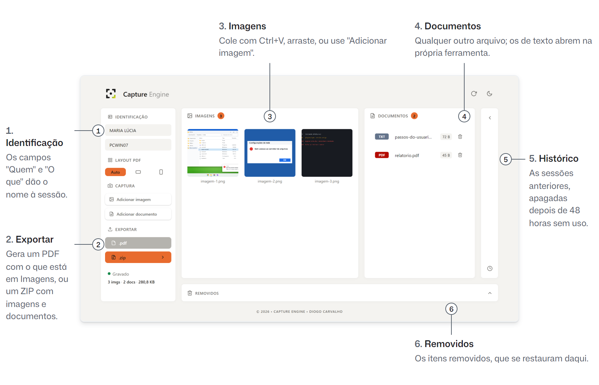
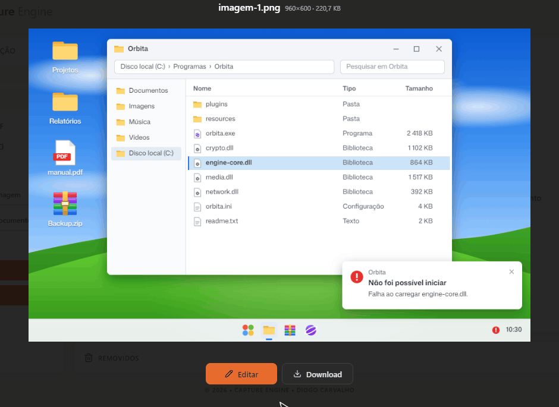
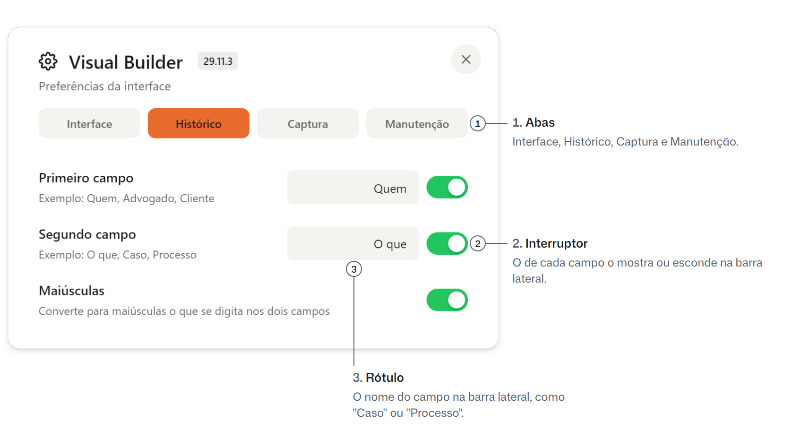
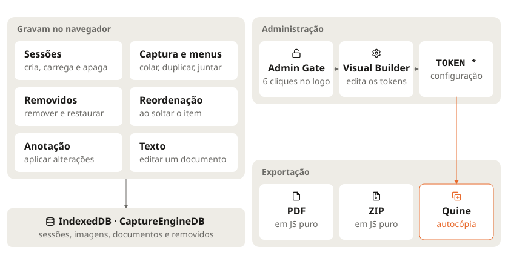
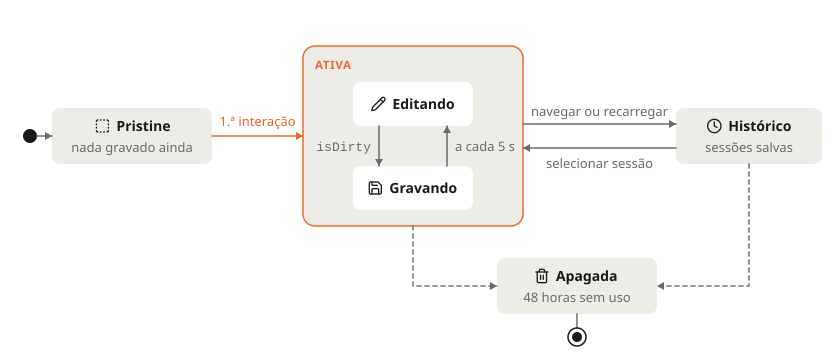
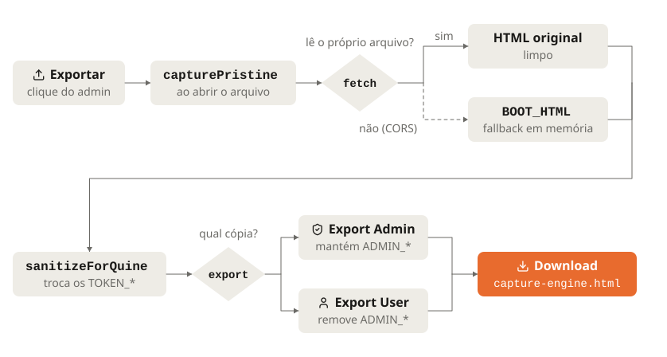

# Capture Engine

   

Ferramenta para capturar, organizar e exportar imagens e documentos como evidência, em PDF ou ZIP, em um único arquivo HTML que abre no navegador e funciona sem internet.

<!-- cartoes: logotipo=docs/images/logo.svg; arquivo=capture-engine.html; site=diogocarvalhoinfo.github.io/capture-engine; cor=#e86b2e -->
<a href="https://github.com/diogocarvalhoinfo/capture-engine/releases/latest/download/capture-engine.html"><picture><source media="(prefers-color-scheme: dark)" srcset="docs/images/card-download-dark.svg"></picture></a><br>
<a href="https://diogocarvalhoinfo.github.io/capture-engine/"><picture><source media="(prefers-color-scheme: dark)" srcset="docs/images/card-site-dark.svg"></picture></a>

## Índice

1. [O que é](#1-o-que-é)
2. [Para quem é](#2-para-quem-é)
3. [Stack](#3-stack)
4. [Conceitos](#4-conceitos)
5. [Início rápido](#5-início-rápido)
6. [Capturar e organizar](#6-capturar-e-organizar)
7. [Ver e anotar imagens](#7-ver-e-anotar-imagens)
8. [Exportar PDF e ZIP](#8-exportar-pdf-e-zip)
9. [Configurar e distribuir](#9-configurar-e-distribuir)
10. [Privacidade](#10-privacidade)
11. [Limitações conhecidas](#11-limitações-conhecidas)
12. [Resolução de problemas](#12-resolução-de-problemas)
13. [Perguntas frequentes](#13-perguntas-frequentes)
14. [Requisitos](#14-requisitos)
15. [Estrutura de arquivos](#15-estrutura-de-arquivos)
16. [Arquitetura](#16-arquitetura)
17. [Contribuição](#17-contribuição)
18. [Licença](#18-licença)

## 1. O que é

<!-- imagem-anotada: url=http://127.0.0.1:8765/capture-engine.html; saida=docs/images/overview.png; preparo=capture-engine-overview -->
<picture><source media="(prefers-color-scheme: dark)" srcset="docs/images/overview-dark.png"></picture>

1. **Identificação**: os campos "Quem" e "O que" dão o nome à sessão. <!-- anotação: alvo=#id-section-wrap; lado=esquerda; ponto=0,0.5 -->
2. **Exportar**: gera um PDF com o que está em Imagens, ou um ZIP com imagens e documentos. <!-- anotação: alvo=#export-section; lado=esquerda; ponto=0,0.5 -->
3. **Imagens**: cole com Ctrl+V, arraste, ou use "Adicionar imagem". <!-- anotação: alvo=#img-zone; lado=cima; ponto=0.5,0 -->
4. **Documentos**: qualquer outro arquivo; os de texto abrem na própria ferramenta. <!-- anotação: alvo=#doc-zone; lado=cima; ponto=0.9,0 -->
5. **Histórico**: as sessões anteriores, apagadas depois de 48 horas sem uso. <!-- anotação: alvo=#sb-rail; lado=direita; ponto=1,0.3 -->
6. **Removidos**: os itens removidos, que se restauram daqui. <!-- anotação: alvo=#trash-bar; lado=baixo; ponto=0.85,1 -->

O Capture Engine é um arquivo HTML que guarda capturas de tela, fotos e documentos, anota as imagens e as exporta em PDF ou ZIP. Não precisa de instalação nem de internet, e nada sai do computador.

Funciona como uma pasta que vive dentro de um arquivo: você abre, cola ou arrasta, organiza, anota e exporta.

> [!CAUTION]
> **Os dados não ficam guardados para sempre.**
> O Capture Engine apaga sozinho a sessão que fica mais de 48 horas sem uso, e não faz cópia de segurança. Para guardar um trabalho, exporte-o em PDF ou ZIP e guarde o arquivo.

<details>
<summary>Casos de uso</summary>

| Situação | Como o Capture Engine ajuda |
|---|---|
| Suporte técnico | Junta capturas de erros, registros e configurações em um único PDF para o chamado |
| Área jurídica | Reúne e exporta provas e documentos para processos ou audiências |
| Uso pessoal | Agrupa capturas para enviar em um portal ou formulário |
| Ambientes restritos (banco, governo, saúde) | Funciona sem internet e sem nenhum recurso de fora |
| Auditoria e conformidade | Documenta e exporta evidências sem sair do computador |

</details>

## 2. Para quem é

- **Quem usa:** captura, organiza, anota e exporta, com o arquivo que recebeu já configurado.
- **Quem administra:** configura o nome, as cores, os campos e o rodapé, e distribui a cópia configurada.
- **Quem edita o código:** muda o `capture-engine.html` seguindo as regras do `AGENTS.md`.

Veja também: [`AGENTS.md`](AGENTS.md).

## 3. Stack

HTML, CSS e JavaScript em um único arquivo, o `capture-engine.html`, sem bibliotecas. Não há manifesto nem gerenciador de pacotes: o próprio arquivo é a aplicação.

## 4. Conceitos

- **Sessão:** um conjunto de trabalho, como uma pasta. Cada abertura no computador começa uma sessão nova, e as anteriores ficam no Histórico.
- **Histórico:** a gaveta das sessões anteriores, no ícone de relógio, à direita.
- **Removidos:** a lixeira de cada sessão, na barra do fundo da tela. Um item removido volta daqui até a sessão expirar.
- **Banco de dados do navegador:** o lugar, dentro do navegador, onde o Capture Engine grava as sessões. É como uma gaveta que pertence ao navegador, e não ao arquivo: trocar o arquivo não esvazia a gaveta, mas limpar os dados do navegador esvazia.
- **Modo administrador:** o modo escondido de quem configura a ferramenta. Abre com 6 cliques seguidos no logotipo.
- **Visual Builder:** o painel de configuração do modo administrador, onde se mudam o nome, as cores, os campos e o rodapé.
- **Cópia "Administrador" e cópia "User":** as duas formas de exportar a ferramenta configurada. A "Administrador" guarda o modo administrador; a "User" sai sem ele, para quem só usa.

> [!CAUTION]
> **Exportar a ferramenta não guarda os dados.**
> A cópia "Administrador" ou "User" leva só a configuração e o código. As imagens, os documentos e o histórico ficam no banco de dados do navegador.

## 5. Início rápido

1. Faça o download do `capture-engine.html` pelo cartão "Download", no topo deste README.
2. Abra o arquivo com um clique duplo: ele abre no navegador.
3. Cole uma captura com Ctrl+V, ou arraste um arquivo para a tela.
4. Preencha "Quem" e "O que" para dar nome à sessão.
5. Clique em ".pdf" ou em ".zip" para guardar o resultado.

No iPhone, use o site, pelo cartão "Abrir o site": o arquivo guardado abre no app Arquivos só como pré-visualização.

<details>
<summary>Dicas</summary>

- O Ctrl+V cola uma imagem, um arquivo copiado ou um texto, que vira um `.txt`.
- Arrastar funciona direto da Área de Trabalho ou do explorador de arquivos.
- O botão "Nova sessão", no topo, começa uma sessão nova; a anterior fica no Histórico.
- No telefone e no tablet, abrir o site volta à última sessão.
- A aplicação grava a cada 5 segundos. Fechar o navegador antes disso perde as últimas mudanças.

</details>

## 6. Capturar e organizar

| Como | O que captura |
|---|---|
| Ctrl+V, com o foco na ferramenta | A imagem copiada, um arquivo copiado ou um texto |
| Arrastar e soltar | Qualquer arquivo |
| "Adicionar imagem" e "Adicionar documento" | Qualquer arquivo, pelo seletor do sistema |

Uma imagem vai para Imagens; qualquer outro arquivo vai para Documentos. Os nomes nunca se repetem: a segunda imagem colada chama-se `imagem-2`, e uma renomeação segue a mesma regra.

O clique direito em um item abre o menu do lugar: abrir, editar, copiar (Ctrl+C), duplicar, renomear (F2), fazer o download e remover (Del). Copiar leva a imagem, ou o texto de um documento de texto. "Marcar" põe uma caixa em cada item para agir em vários de uma vez, e "Desmarcar todos" (Esc) tira as caixas. Arrastar um item muda a ordem, e a ordem nova fica gravada.

Fora desses menus, o clique direito não abre o menu do navegador, a não ser em um campo de texto. O Shift + clique direito abre o menu do navegador em qualquer lugar.

Um item removido vai para a barra "Removidos", no fundo da tela, e volta pelo botão "Restaurar" até a sessão expirar. O clique direito nele abre, restaura ou faz o download.

> [!CAUTION]
> **Apagar uma sessão não tem volta.**
> O ✕ de uma sessão no Histórico apaga na hora, sem confirmação, com tudo o que ela tem, inclusive os removidos. Exporte antes a sessão que ainda pode servir.

<details>
<summary>Tipos de arquivo</summary>

| Tipo | Formatos e o que acontece |
|---|---|
| Imagens | PNG, JPEG, WEBP e GIF. Uma imagem com uma extensão que o navegador não conhece é reconhecida pelo conteúdo. |
| Texto | TXT, CSV, XML, JSON, Markdown, HTML e outros de texto simples. Abrem no visualizador: o Markdown formatado, o CSV em uma tabela e o HTML como página, isolado. "Editar" muda o texto, com "Descartar alterações" e "Aplicar alterações". |
| PDF | Abre no leitor do próprio navegador. Arrastado para Imagens, fica junto das fotos e entra no PDF exportado. |
| Outros | DOCX, XLSX e qualquer outro formato ficam guardados, sem pré-visualização, com o download. |

</details>

<details>
<summary>Menus e marcação</summary>

- "Marcar" fica ligado até se desmarcar tudo. O Esc ou um clique fora dos itens desmarca.
- Com vários itens marcados, o menu faz o download deles em um `.zip`, ou em um `.pdf` quando nenhum está em Documentos, ou os remove.
- Com dois ou mais PDFs marcados, "Juntar em um PDF" cria `juntado.pdf` em Documentos, com as páginas na ordem da lista.
- Em um PDF, "Diminuir o tamanho" cria uma cópia menor, em três níveis, com o tamanho de cada um.

</details>

<details>
<summary>Sessões e Histórico</summary>

- No computador, cada abertura começa com uma sessão em branco. No telefone e no tablet, a ferramenta volta à última sessão; "Nova sessão" começa outra.
- A sessão nova só entra no Histórico depois da primeira ação: colar, arrastar ou digitar no "Quem".
- O nome da sessão junta "Quem" e "O que", em maiúsculas quando "Maiúsculas" está ligado. Sem nome, a sessão recebe um número, como `#0001`.
- A sessão sem atividade há mais de 48 horas é apagada ao abrir a ferramenta. O prazo conta da última atividade, e quem administra pode mudá-lo.
- Para trocar de sessão, abra o Histórico e clique na sessão. A atual é gravada antes.

</details>

## 7. Ver e anotar imagens

Um clique em uma imagem abre o visualizador. O título é o nome com a extensão, e logo depois vêm as dimensões e o tamanho.

| Ação | Como fazer |
|---|---|
| Zoom | A rolagem do mouse, a pinça no telefone ou os botões + e −, de 20% a 1000%. O valor volta a 100% com um clique. |
| Mover a imagem ampliada | Arrastar |
| Trocar de imagem | As setas nas laterais, ou as teclas ← e → |
| Fechar | O ✕, ou um clique fora da imagem com o zoom em 100% |

<!-- gif: url=http://127.0.0.1:8765/capture-engine.html; saida=docs/images/annotation-arrow.gif; preparo=capture-engine-editor-arrow; recorte=#img-modal-img, #img-modal-default-actions; passos=clicar #ann-toggle | clicar .ann-btn[data-tool=arrow] | arrastar #ann-canvas 18%,59% 31%,44% -->
<picture><source media="(prefers-color-scheme: dark)" srcset="docs/images/annotation-arrow-dark.gif"></picture>

O GIF mostra o "Editar" abrindo as ferramentas e a Seta desenhada por um arrasto.

- O editor tem 8 ferramentas (desenho livre, retângulo, círculo, seta, marca-texto, texto, selecionar e recortar) e o botão Girar 90°.
- A barra tem também 8 cores e a "Outra cor", "Diminuir" e "Aumentar" para a espessura, "Desfazer", "Refazer", "Descartar alterações" e "Aplicar alterações".
- Um clique na ferramenta já escolhida abre as opções dela, como "Preenchido" e "Desfocado" no retângulo.
- "Aplicar alterações" grava as anotações na imagem. O original continua guardado, e o "Desfazer" volta a ele ao reabrir a imagem.

<details>
<summary>Opções das ferramentas</summary>

- **Abrir as opções:** um clique na ferramenta já escolhida, o clique duplo, o botão apertado por 1 segundo ou arrastar a ferramenta para cima. A seta para cima abre pelo teclado.
- **Fechar as opções:** um clique fora, o Esc, outra ferramenta ou arrastar para baixo.
- **Retângulo e círculo:** "Contorno", "Preenchido", uma forma cheia que cobre o que está embaixo, ou "Desfocado", que esconde um dado antes de exportar. Para um dado muito sensível, use "Preenchido".
- **Marca-texto:** "Translúcido", com 40% de opacidade, ou "Sólido", que cobre. Começa no amarelo e guarda a sua cor.
- **Texto:** "Negrito" e "Itálico" (Ctrl+B e Ctrl+I), e "Com fundo" ou "Fundo transparente". Um clique duplo em um texto, ou "Editar texto" no clique direito, o reabre.
- **Espessura:** cada ferramenta guarda a sua. O desenho livre, o retângulo, o círculo e a seta começam com 4 px, o marca-texto com 18 px, e o texto com 24. Em uma foto grande, os passos crescem na mesma proporção. Em uma captura de tela de telefone, crescem com a densidade da tela: o texto nasce com 64 px em um iPhone.
- **Outra cor:** o círculo do arco-íris abre o conta-gotas, o código HEX e um quadrado de tons.
- **Recortar:** "Retângulo", "Cantos livres", que endireita uma folha fotografada de lado, e "Endireitar", que gira a foto olhando a grade.

</details>

<details>
<summary>Selecionar, mover e atalhos</summary>

- **Selecionar:** um clique seleciona uma anotação; o Delete ou o ✕ ao lado da seleção a apagam, e o Ctrl+Z a devolve. O Ctrl+A seleciona todas.
- **Mover:** arrastar uma anotação. O botão direito, o do meio ou o Ctrl seleciona e move em qualquer ferramenta. No telefone, um toque longo de meio segundo faz o mesmo.
- **Redimensionar:** as alças dos cantos. A seta tem uma alça em cada ponta.
- **Shift:** quadrado, círculo perfeito, e seta e desenho livre em passos de 45°.
- **Camadas:** "Trazer para frente" (Ctrl+]) e "Enviar para trás" (Ctrl+[).
- **Menu da anotação:** o clique direito em uma anotação já selecionada, ou no Selecionar, abre o menu: "Trazer para frente", "Enviar para trás", "Duplicar" e "Apagar". Em um texto, também "Editar texto", o negrito (Ctrl+B), o itálico (Ctrl+I), o fundo e o tamanho. Cada item diz o que faz, como "Tirar negrito", e o − e o + do tamanho deixam o menu aberto. Em um retângulo ou um círculo, "Preencher" e "Desfocar"; em uma linha, a espessura. Em outra ferramenta, o primeiro clique direito só seleciona. Fora de uma anotação, o clique direito na foto abre "Selecionar tudo", "Desfazer" e "Refazer".
- **Girar um texto:** o botão redondo acima do texto selecionado. Prende em 0°, 90°, 180° e 270°; com Shift, anda de 15° em 15°.
- **Colar por cima:** com o editor aberto, o Ctrl+V cola uma imagem como anotação.
- **Zoom no editor:** a rolagem do mouse e os botões + e −. Para mover a imagem ampliada, use a barra de espaço com o arrasto, ou o botão do meio.
- **Desfazer e Refazer:** até 50 passos, também para o recorte e o Girar 90°.
- **Fechar com anotações por salvar:** um balão pede "Aplique ou descarte as alterações", e o resto do editor fica apagado até o próximo clique. Escolha "Descartar alterações" ou "Aplicar alterações"; um clique em outro lugar do editor volta à edição. O editor de texto mostra o mesmo balão.

</details>

<details>
<summary>No telefone</summary>

- O desenho com o dedo cai onde o dedo passa.
- A barra quebra em linhas conforme a largura, e até 480 px as ferramentas ficam em uma linha só.
- Os botões de apagar e de restaurar ficam sempre à vista.

</details>

## 8. Exportar PDF e ZIP

| Botão | O que leva |
|---|---|
| .pdf | Tudo o que está em Imagens: uma foto por página e as páginas de cada PDF que está ali. Fica desativado quando há documentos. |
| .zip | Imagens e documentos. Com imagens na sessão, o .zip pergunta: "Imagens em PDF" ou "Imagens separadas". |

Depois de exportar, o botão fica verde, com "Concluído", até a próxima ação na página.

O PDF converte as fotos em JPEG, com qualidade de 92%, em uma página A4. O layout "Auto" escolhe vertical ou horizontal para cada foto; "Horizontal" e "Vertical" valem para todas. O ZIP leva cada imagem não editada igual ao original, byte a byte.

> [!CAUTION]
> **O ZIP leva a imagem que você vê, e não a que colou.**
> Uma imagem anotada, girada ou recortada vai para o ZIP como um PNG novo. Para guardar o original intacto, exporte o ZIP antes de editar.

<details>
<summary>Detalhes do PDF e do ZIP</summary>

- O PDF não guarda a transparência: um PNG transparente ganha fundo branco. O ZIP guarda.
- De um GIF animado, o PDF leva só o primeiro quadro. O ZIP leva o GIF inteiro enquanto ele não for editado.
- Os nomes no ZIP guardam os acentos e os espaços. Os caracteres que o Windows não aceita em nomes de arquivo (`\ / : * ? " < > |`) saem dos nomes.
- Um ZIP feito por uma versão antiga pode mostrar acentos trocados. Exporte de novo para ter os nomes certos.
- O original de uma imagem editada continua guardado até a sessão expirar. Para o ZIP voltar a levá-lo, reabra a imagem, desfaça tudo e aplique.

</details>

<details>
<summary>Uso como prova</summary>

O Capture Engine organiza e documenta evidências, mas não é uma cadeia de custódia forense.

- **O que a ferramenta garante:** a data de criação e da última atividade de cada sessão, pelo relógio do computador. Os dados só saem do computador por uma exportação, e o ZIP de imagens não editadas leva os originais, byte a byte.
- **O que não garante:** nenhum hash, assinatura digital ou carimbo de tempo independente; os dados no navegador podem ser alterados; nenhum registro de acessos.
- O PDF recomprime as fotos em JPEG, com perda. Quando se exige a imagem igual pixel a pixel, use o ZIP de imagens não editadas.
- Exporte o ZIP logo depois da captura, antes de qualquer edição, e guarde esse arquivo como referência.
- Em um processo judicial ou uma auditoria regulada, complete com um procedimento de custódia externo, como um hash dos arquivos exportados.

</details>

## 9. Configurar e distribuir

Quem administra muda o nome, as cores, os campos e o rodapé, e exporta uma cópia configurada para quem usa.

1. Clique 6 vezes seguidas no logotipo, no canto superior esquerdo, em menos de 3 segundos.
2. Clique na engrenagem para abrir o Visual Builder e faça as mudanças.
3. Clique no disquete e escolha "Administrador", para guardar a configuração, ou "User", para distribuir.

Para sair do modo administrador, clique 3 vezes no logotipo em menos de 1 segundo, ou feche o Visual Builder pelo ✕. O modo não continua ativo depois de fechar a ferramenta.

<!-- imagem-anotada: url=http://127.0.0.1:8765/capture-engine.html; saida=docs/images/admin-mode.png; preparo=capture-engine-admin-mode; recorte=#vb-overlay .sb-modal -->
<picture><source media="(prefers-color-scheme: dark)" srcset="docs/images/admin-mode-dark.png"></picture>

1. **Abas**: Interface, Histórico, Captura e Manutenção. <!-- anotação: alvo=.sb-tabs; lado=direita; ponto=1,0.5 -->
2. **Interruptor**: o de cada campo o mostra ou esconde na barra lateral. <!-- anotação: alvo=label:has(#cfg-show-pc); lado=direita; ponto=1,0.5 -->
3. **Rótulo**: o nome do campo na barra lateral, como "Caso" ou "Processo". <!-- anotação: alvo=#cfg-equip-label; lado=baixo; ponto=0.5,1 -->

> [!IMPORTANT]
> **As mudanças do Visual Builder só ficam no arquivo depois de exportar.**
> Ao fechar e reabrir o arquivo, a configuração volta à que está gravada nele.

<details>
<summary>As abas do Visual Builder</summary>

- **Interface:** "Cor principal"; "Cor do texto sobre destaque", automática ou escolhida; "Texto inicial", "Texto em destaque" e "Texto final", as três partes do nome no topo, cada uma com a sua cor; "Texto do rodapé", onde `{YEAR}` vira o ano atual.
- **Histórico:** o rótulo e o interruptor do "Primeiro campo" e do "Segundo campo"; "Maiúsculas", que converte o que se digita nos dois campos.
- **Captura:** "Qualidade do PDF", de 70% a 95%; "Dimensão máxima", que reduz as imagens do PDF a 1920, 2560 ou 3840 px, ou "Original".
- **Manutenção:** "Limpeza automática", que apaga as sessões sem uso há mais de 8, 24 ou 48 horas, ou "Nunca".

Os valores padrão de cada configuração estão no [`design-tokens.md`](design-tokens.md), seção 6.

</details>

<details>
<summary>Distribuir uma versão nova</summary>

Os dados das sessões não estão no arquivo, e trocar o arquivo não os apaga nem os muda.

1. Antes de trocar, exporte a cópia "Administrador" da versão atual, para guardar a configuração.
2. Abra o arquivo novo, ative o modo administrador e refaça a configuração, com a cópia do passo 1 como referência.
3. Exporte a cópia "User" e distribua-a.
4. Quem usa abre o arquivo novo, e as sessões anteriores aparecem, no mesmo navegador e perfil.

Uma versão nova com um prazo de limpeza menor apaga, na primeira abertura, as sessões que antes ficariam.

</details>

## 10. Privacidade

- **O que vai para a rede:** nada. O arquivo não carrega nada de fora, não envia dados e não tem telemetria. A única leitura é do próprio arquivo, ao exportar uma cópia configurada.
- **O que fica gravado:** no banco de dados do navegador, as sessões, as imagens, os documentos e os removidos. Ficam até a limpeza automática ou até alguém limpar os dados do navegador. No armazenamento local do navegador, o tema escolhido, as opções das ferramentas do editor e o código da última sessão aberta, que só o telefone e o tablet usam.

Os dados ficam no navegador e no perfil onde foram criados, e cada endereço tem a sua base: o arquivo aberto do computador e o site publicado não se veem.

Veja também: [`AGENTS.md`](AGENTS.md), seção "Regras".

## 11. Limitações conhecidas

| Limitação | Detalhe |
|---|---|
| Sem sincronização | Os dados ficam no navegador e no perfil onde foram criados. A mesma conta em outro computador não traz as sessões. |
| Limpar o navegador apaga tudo | Limpar os dados do navegador apaga as sessões. Exporte antes o que importa. |
| Várias abas | As abas do mesmo navegador usam a mesma base. Editar a mesma sessão em duas abas faz a última gravação apagar a outra. |
| PDF sem documentos | O .pdf leva só o que está em Imagens. Um PDF protegido por senha, em Imagens, interrompe a exportação. |
| Sem pré-visualização do Office | Os documentos do Word, do Excel e do PowerPoint só têm o download. |
| PDF no iPhone | O PDF abre no leitor do Safari, que pode mostrar só a primeira página. Não foi testado em um iPhone. |
| Cópias anteriores à 29 | Depois de abrir a versão 29, uma cópia mais antiga no mesmo navegador mostra "Armazenamento indisponível". Use sempre a versão mais nova. |
| Espaço do navegador | Sem espaço, as capturas novas ficam só na aba, e um aviso vermelho aparece no topo. Editar uma imagem guarda o original e a versão editada. |
| Navegação privada | Em alguns navegadores, as capturas ficam só na aba, com "Não gravado" na barra de estado. Exporte antes de fechar a aba. |
| Página HTML com código | Uma página HTML aberta executa o próprio JavaScript, sem acesso às sessões nem à internet. Depois de um clique dentro dela, ela pode trocar o que está na área de transferência. Abra só páginas de quem você confia. |

<details>
<summary>Outras limitações</summary>

| Limitação | Detalhe |
|---|---|
| Lista do .7z | Um .zip, .tar, .tar.gz ou .rar mostra a lista de arquivos; um .7z não. |
| Formatos que o navegador não abre | Uma foto HEIC, TIFF ou RAW vai para Documentos, com um aviso. O ZIP leva o original; no Safari, que abre HEIC, a foto fica em Imagens. |
| ZIP de até 65 535 arquivos e cerca de 4 GB | Acima disso, o ZIP sai corrompido sem aviso. O navegador fica sem memória antes de chegar lá. |
| PNG transparente no PDF | O PDF põe fundo branco. O ZIP guarda a transparência. |
| GIF animado | O PDF leva só o primeiro quadro. Editado, o GIF vira um PNG parado também no ZIP. |
| Leitores de tela | Não foram testados. |
| Safari no Mac | Não foi testado. Aberto como arquivo, pode exportar a cópia a partir do estado em que a página abriu. |

</details>

## 12. Resolução de problemas

| Sintoma | Causa | Solução |
|---|---|---|
| A página abre em branco | Navegador antigo, ou arquivo local bloqueado | Use uma versão recente do Chrome, do Edge, do Firefox ou do Safari, e abra o arquivo com um clique duplo. |
| As sessões sumiram | Os dados do navegador foram limpos, ou a sessão passou de 48 horas sem uso | Não há volta. Exporte com frequência; quem administra muda o prazo em "Limpeza automática". |
| As sessões não aparecem em outra cópia | Outro navegador, outro perfil, janela privada, ou site em vez de arquivo | Abra no mesmo navegador, perfil e endereço onde as sessões foram criadas. |
| As capturas sumiram ao fechar o navegador | Sem espaço, ou aba privada: a barra dizia "Não gravado" | Exporte antes de fechar, e elimine no Histórico as sessões que já não servem. |
| O Ctrl+V não cola | O foco está em um campo de texto, ou o telefone não tem teclado | Clique fora dos campos; no telefone, use "Adicionar imagem". |
| O .pdf está desativado | Há documentos na sessão | Use o .zip, ou arraste o PDF de Documentos para Imagens. |
| O Esc não fecha o editor | As opções de uma ferramenta estão abertas, ou há anotações por salvar | Aperte o Esc de novo, ou escolha "Aplicar alterações" ou "Descartar alterações". |

<details>
<summary>Como confirmar a causa</summary>

- **Falta de espaço:** abra as ferramentas do navegador (F12), na aba Console, e procure erros com `quota` ou `storage`.
- **Onde estão os dados:** nas ferramentas do navegador (F12), aba Application, IndexedDB, base `CaptureEngineDB`.
- **Arquivo HTML perdido:** os dados não estão no arquivo. Abra qualquer cópia da ferramenta no mesmo navegador e perfil, e as sessões aparecem. Dentro de um ZIP sem extrair, ou no atalho da Tela de Início do iPhone, a base é outra.
- **Área de trabalho virtual (VDI):** os dados ficam no perfil daquela máquina. Em um perfil com roaming, confirme com a equipe de TI.

</details>

## 13. Perguntas frequentes

**O arquivo tem mais de 500 KB. É normal?**
Sim. O arquivo tem a aplicação inteira, com o CSS, o JavaScript e os ícones. A cópia "User" é menor, sem o Visual Builder.

**Posso usar no Mac, no Linux ou no Firefox?**
Sim: abra o `capture-engine.html` no navegador. Cada navegador tem a sua base, e as sessões de um não aparecem no outro.

**Posso usar o Edge e o Chrome com o mesmo histórico?**
Não. Cada navegador guarda o seu histórico, mesmo com a mesma conta.

**Posso abrir várias abas?**
Sim, e todas leem a mesma base. Não edite a mesma sessão em duas abas ao mesmo tempo.

**Posso usar a ferramenta em um servidor?**
Sim. O site publicado funciona como o arquivo, com uma base separada. Um servidor que muda o HTML antes de entregá-lo pode estragar a cópia exportada; nesse caso, use o arquivo.

**Posso personalizar sem programar?**
Sim, pelo Visual Builder, no modo administrador.

**O que acontece se eu escrever um marcador interno, como `EXPORT MODAL`, no rodapé?**
Nada. A ferramenta protege os marcadores internos, e a cópia exportada sai certa.

## 14. Requisitos

**Versão:** 29.13.1. As mudanças de cada versão estão no [CHANGELOG.md](CHANGELOG.md).

- **Navegadores:** Chrome, Edge e Firefox no computador; Safari no iPhone, pelo site.
- **Sistemas:** Windows, macOS e Linux, com um desses navegadores.
- **Instalação e internet:** nenhuma das duas.
- **Recuperar dados de um arquivo perdido:** testado no Chrome, no Edge, no Firefox e no Safari do iPhone.

As versões testadas de cada navegador estão no changelog.

<details>
<summary>Acessibilidade</summary>

Medido só com o teclado, com o Playwright, no Edge, no Firefox e no WebKit, o motor do Safari. O resultado foi o mesmo nos três.

- **Teclado:** o Tab alcança todos os controles, e o Enter ou o Espaço os ativam. Isso inclui as miniaturas, os documentos, os removidos, as sessões, os chips do layout do PDF, as abas do Visual Builder e os cartões de exportação. No editor de anotação, o Espaço segurado é o gesto de mover a imagem, e o Enter ativa os botões.
- **Botões que aparecem com o mouse:** a lixeira e o botão de restaurar aparecem também com o foco.
- **Barras recolhidas:** com o Histórico ou os "Removidos" fechados, o Tab passa só pelas setas que os abrem.
- **Janelas:** com uma janela aberta, o Tab fica dentro dela, e ao fechar o foco volta ao lugar de onde ela abriu.
- **Esc:** no editor, fecha primeiro as opções da ferramenta. Fecha também o visualizador, o texto e a exportação. O Visual Builder fecha só pelo ✕.
- **Foco visível:** um contorno de 2 px, afastado 2 px, na cor principal escurecida, com pelo menos 3:1 sobre o fundo.
- **Contraste:** o texto tem pelo menos 4,5:1 nos dois temas, com a cor principal padrão. A exceção é o "Concluído" e o "Copiado", em branco sobre o verde, com 3,30:1.
- **Ampliar:** no telefone, a pinça amplia só a foto do visualizador. Para letra maior, use o tamanho de letra do navegador.
- **Safari no Mac:** o Tab passa só pelos campos de texto. Ligue "Pressionar Tab para destacar cada item" nos ajustes avançados, ou use Option+Tab.
- **Leitores de tela:** não testados. Os avisos de armazenamento usam `role="alert"`; os botões só com ícone têm o nome no `aria-label`; as ferramentas do editor dizem a escolhida com `aria-pressed`.
- **Conformidade formal:** nenhuma auditoria de WCAG ou EN 301 549 foi feita.

</details>

## 15. Estrutura de arquivos

```text
capture-engine/
├── capture-engine.html   ← a aplicação inteira; é o arquivo que se distribui
├── index.html            ← entrada do GitHub Pages; abre o capture-engine.html
├── README.md             ← este guia
├── AGENTS.md             ← regras para quem edita o projeto, pessoa ou IA
├── CHANGELOG.md          ← as versões, da mais nova para a mais antiga
├── design-tokens.md      ← o nome e o valor de cada token visual
├── .gitattributes        ← fim de linha LF em qualquer computador
├── .gitignore            ← pastas locais de ferramentas de IA fora do git
├── docs/images/          ← imagens, GIF, cartões e diagramas deste README
└── LICENSE               ← licença MIT
```

Para quem usa, basta o `capture-engine.html`. Os outros arquivos são a documentação e as ferramentas do projeto.

## 16. Arquitetura

Esta seção é para quem edita o código.

### O arquivo único

```text
capture-engine.html
│
├── <head>
│   └── <meta> da CSP      → o que a página pode carregar
│
├── <style>
│   ├── Design tokens      → as variáveis CSS
│   ├── :root              → o tema claro
│   ├── html.dark          → o tema escuro
│   ├── Layout principal   → as colunas da tela
│   ├── Componentes        → botões, janelas, barras laterais e cartões
│   ├── Responsividade     → os cortes estão no design-tokens.md
│   └── Animações          → as @keyframes do app
│
├── <body>
│   ├── Script do tema     → liga o tema escuro antes da primeira pintura
│   ├── Barra de topo      → logotipo, nome e botões de ação
│   ├── Layout principal   → as três colunas
│   │   ├── Barra da esquerda    → identificação, layout do PDF e exportação
│   │   ├── Painel de imagens    → área de soltar e grade de miniaturas
│   │   └── Painel de documentos → área de soltar e lista
│   ├── Barra da direita   → o Histórico das sessões
│   ├── #trash-bar         → a barra dos "Removidos"
│   ├── Rodapé             → o texto do rodapé
│   └── Janelas            → imagem, texto, anotação, Visual Builder, exportação
│
└── <script> — IIFE com 'use strict'
    │
    ├── SysLogger         → os logs do console; info e warn com TOKEN_DEBUG_MODE
    ├── TOKENS            → a configuração, nos TOKEN_*
    ├── escapeHTML()      → escapa o texto do usuário antes do innerHTML
    ├── IndexedDB         → lê e grava a base local (idbGet, idbPut, idbDel…)
    ├── Session Manager   → cria, carrega, apaga e troca as sessões
    ├── Capture Engine    → recebe imagens e documentos, colados ou arrastados
    ├── Reorder           → muda a ordem dos itens ao arrastar
    ├── Annotation        → o editor, um canvas transparente sobre a imagem
    ├── Text Viewer       → abre e edita os documentos de texto
    ├── PDF Engine        → gera o PDF em JavaScript puro
    ├── ZIP Engine        → gera o ZIP em JavaScript puro
    ├── Visual Builder    → o painel de configuração do administrador
    ├── Quine Engine      → exporta a cópia do arquivo com a configuração
    ├── Admin Gate        → liga o modo administrador, com 6 cliques no logotipo
    └── boot()            → chamada por init(); liga todas as partes da tela
```

### Componentes

<!-- diagrama: forma=componentes; saida=docs/images/architecture-components.svg; cor=#e86b2e
grade: Gravam no navegador
  Sessões | cria, carrega e apaga
  Captura e menus | colar, duplicar, juntar
  Removidos | remover e restaurar
  Reordenação | ao soltar o item
  Anotação | aplicar alterações
  Texto | editar um documento
destino: IndexedDB · CaptureEngineDB | sessões, imagens, documentos e removidos | ícone=database
cadeia: Administração
  Admin Gate | 6 cliques no logo | ícone=lock-open
  Visual Builder | edita os tokens | ícone=settings
  `TOKEN_*` | configuração
fila: Exportação
  PDF | em JS puro | ícone=file
  ZIP | em JS puro | ícone=file-archive
  Quine | autocópia | ícone=copy-plus | destaque
liga: TOKEN_* -> Quine
-->
<picture><source media="(prefers-color-scheme: dark)" srcset="docs/images/architecture-components-dark.svg"></picture>

### Ciclo de vida da sessão

<!-- diagrama: forma=estados; saida=docs/images/architecture-session.svg; cor=#e86b2e
início: Pristine | nada gravado | ícone=square-dashed
entrada: 1.ª interação
ativo: Ativa
  Editando | ícone=pencil
  Gravando | ícone=save
  ida: `isDirty`
  volta: a cada 5 s
lado: Histórico | sessões salvas | ícone=clock
  ida: navegar, recarregar
  volta: selecionar sessão
fim: Apagada | 48 horas sem uso | ícone=trash-2
-->
<picture><source media="(prefers-color-scheme: dark)" srcset="docs/images/architecture-session-dark.svg"></picture>

### Fluxo do Quine

<!-- diagrama: forma=fluxo; saida=docs/images/architecture-quine.svg; cor=#e86b2e
passo: Exportar | clique do admin | ícone=upload
passo: `capturePristine` | ao abrir o arquivo
decisão: `fetch` | lê o próprio arquivo?
  sim: HTML original | limpo
  não (CORS): `BOOT_HTML` | fallback em memória | tracejado
passo: `sanitizeForQuine` | troca os TOKEN_*
decisão: `export` | qual cópia?
  Export Admin | mantém ADMIN_* | ícone=shield-check
  Export User | remove ADMIN_* | ícone=user
fim: Download | `capture-engine.html` | ícone=download
-->
<picture><source media="(prefers-color-scheme: dark)" srcset="docs/images/architecture-quine-dark.svg"></picture>

As tabelas do IndexedDB, com cada campo, estão no `AGENTS.md`, em "Armazenamento do navegador".

Veja também: [`AGENTS.md`](AGENTS.md), seções "Regras" e "Armazenamento do navegador".

## 17. Contribuição

Projeto pessoal, sem contribuições externas (nem issues nem pull requests); a licença MIT permite usar e adaptar em um fork.

## 18. Licença

© 2026 Capture Engine · [Diogo Carvalho](https://diogocarvalhoinfo.com) · [GitHub](https://github.com/diogocarvalhoinfo)

Distribuído sob a licença MIT. Consulte o arquivo [LICENSE](LICENSE) para os termos completos.
